<div align="center">

<a href="https://mikhailshap.github.io/kafka-na-paltsah/">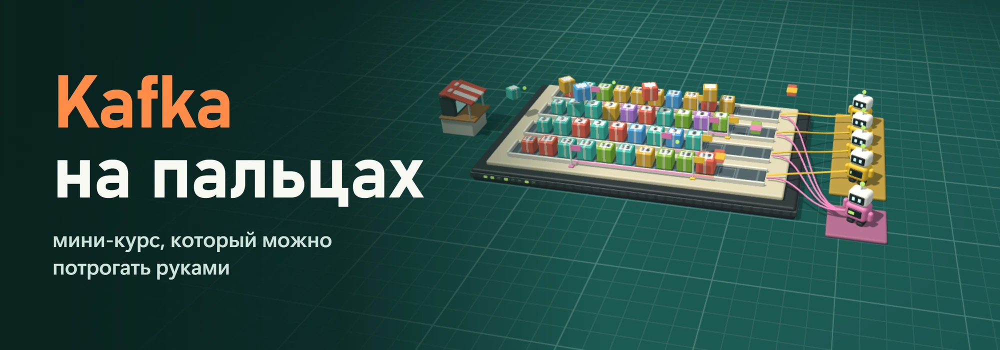</a>

### Интерактивный мини-курс по Kafka: простым языком, на примере пиццерии


### [▶ Открыть курс в браузере](https://mikhailshap.github.io/kafka-na-paltsah/)

[Трейлер](#-трейлер) ·
[Скриншоты](#-скриншоты) ·
[Что внутри](#-что-внутри) ·
[Программа](#-программа) ·
[Как запустить](#-как-запустить) ·
[Честность](#-насколько-это-похоже-на-настоящую-kafka) ·
[Полное описание](docs/course.md)

</div>

---

## 💡 Зачем это всё

Про Kafka обычно рассказывают словами и схемами из квадратиков. Здесь её можно **потрогать**: отправлять посылки,
ронять читателей, перетаскивать закладку, добавлять партиции и сразу видеть, что случилось.

Внутри настоящая маленькая модель Kafka: партиция по ключу, раздача партиций внутри группы, rebalance, lag, срок хранения.
Каждое слово объясняется там, где появилось впервые. Отдельный упор на **нагрузочное тестирование (НТ)**: как подать
нагрузку из JMeter, что мерить, когда HTTP-ответ ничего не значит, и как понять, кто упёрся.

## 🎬 Трейлер

<div align="center">

<a href="https://mikhailshap.github.io/kafka-na-paltsah/trailer.mp4">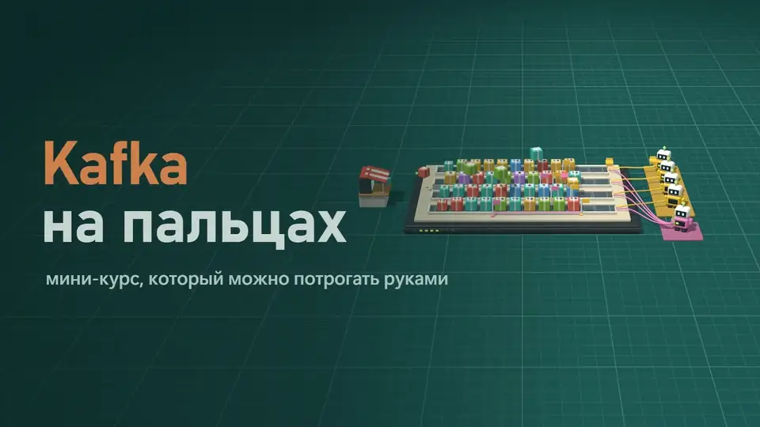</a>

**[▶ Смотреть трейлер целиком со звуком](https://mikhailshap.github.io/kafka-na-paltsah/trailer.mp4)** · 1:44 · [файл в репозитории](trailer.mp4)

</div>

## 📸 Скриншоты

<table>
<tr>
<td width="50%" valign="top"><a href="docs/img/3d.webp">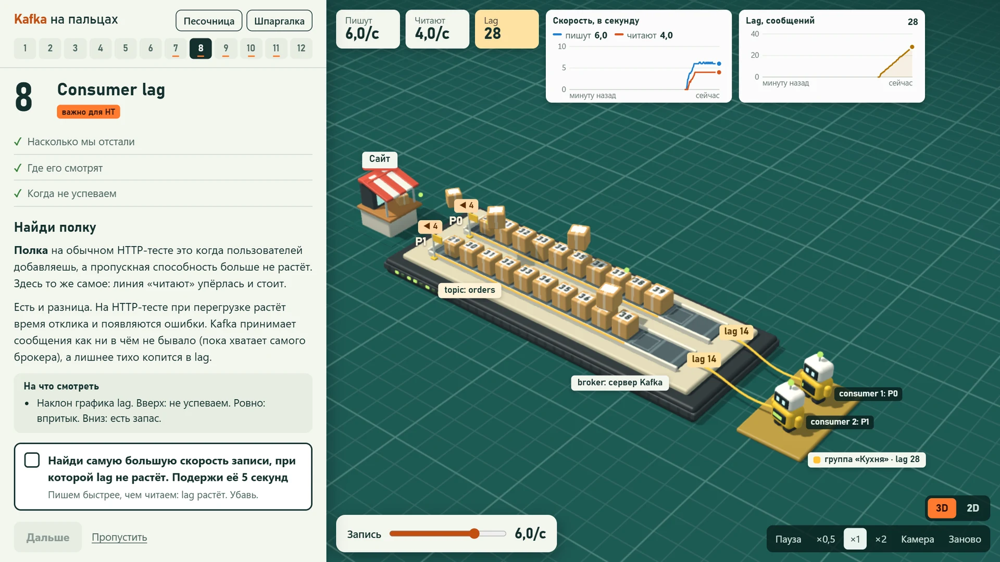</a><br><sub>Режим 3D. Ищем полку: lag растёт, потому что пишут быстрее, чем читают</sub></td>
<td width="50%" valign="top"><a href="docs/img/2d.webp">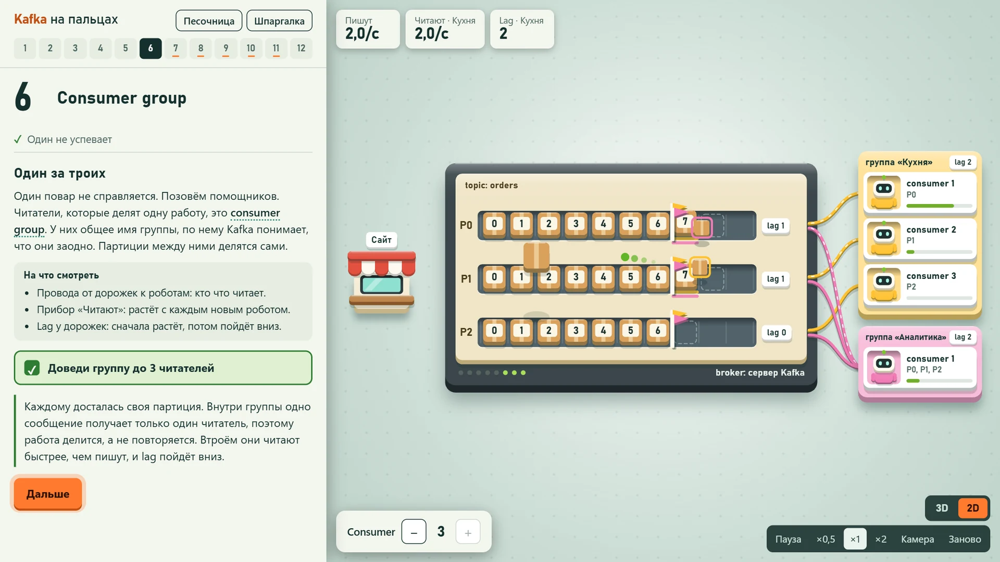</a><br><sub>Режим 2D. Две группы независимо читают один топик</sub></td>
</tr>
<tr>
<td width="50%" valign="top"><a href="docs/img/jmeter.webp">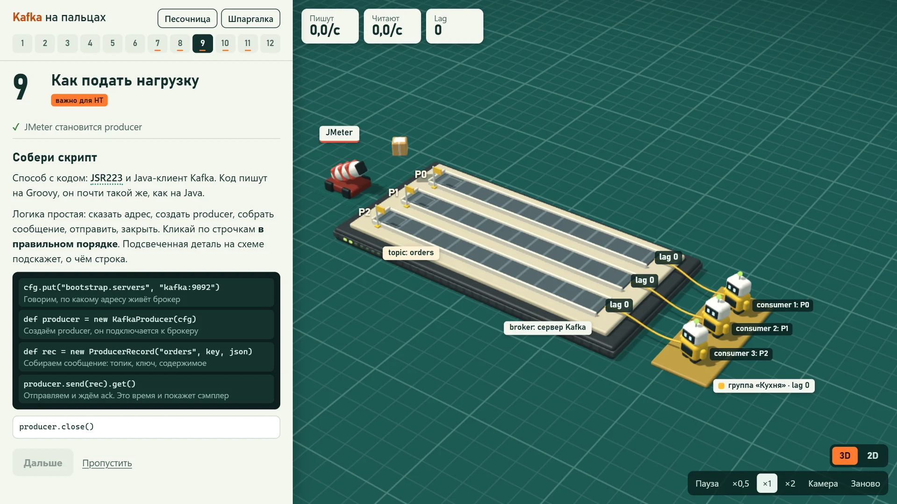</a><br><sub>Собираем скрипт для JMeter по строчкам, сообщение сразу улетает в топик</sub></td>
<td width="50%" valign="top"><a href="docs/img/ack.webp">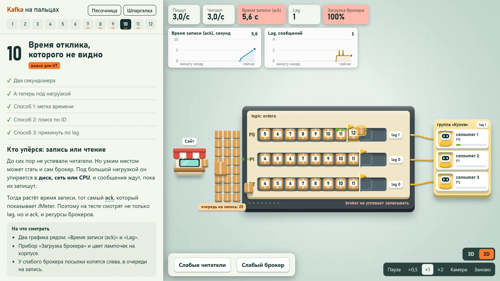</a><br><sub>Упёрся брокер: ack растёт, а lag около нуля</sub></td>
</tr>
<tr>
<td width="50%" valign="top"><a href="docs/img/id.webp">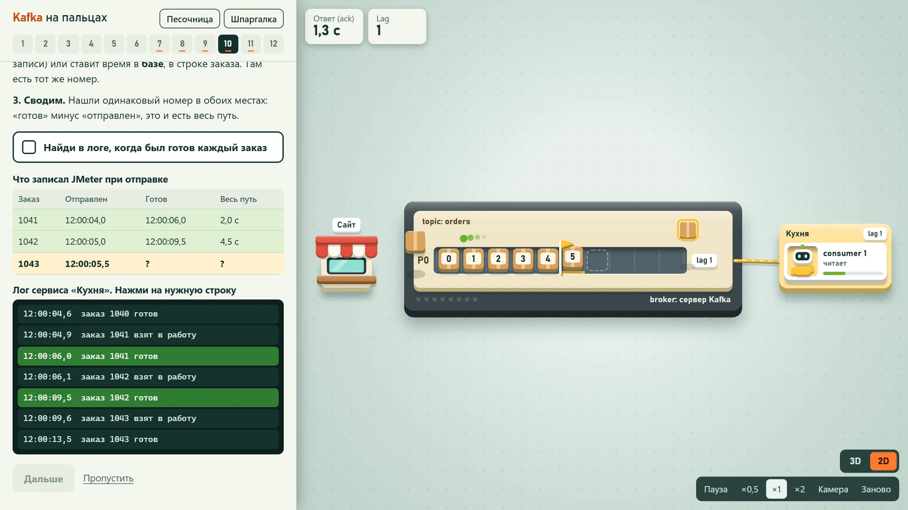</a><br><sub>Сводим время по ID: что записал JMeter и что написал сервис</sub></td>
<td width="50%" valign="top"><a href="docs/img/boss.webp">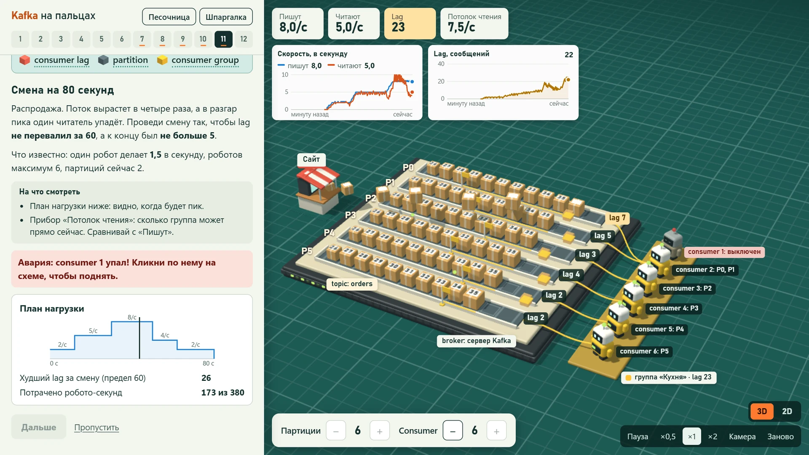</a><br><sub>Босс «Чёрная пятница»: в разгар пика упал читатель</sub></td>
</tr>
<tr>
<td width="50%" valign="top"><a href="docs/img/exam.webp">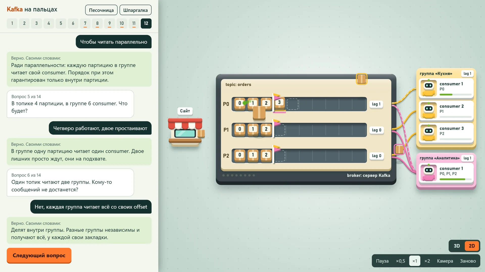</a><br><sub>Мини-собес: вопрос, ответ своими словами, живой пример на схеме</sub></td>
<td width="50%" valign="top"><a href="docs/img/sandbox.webp">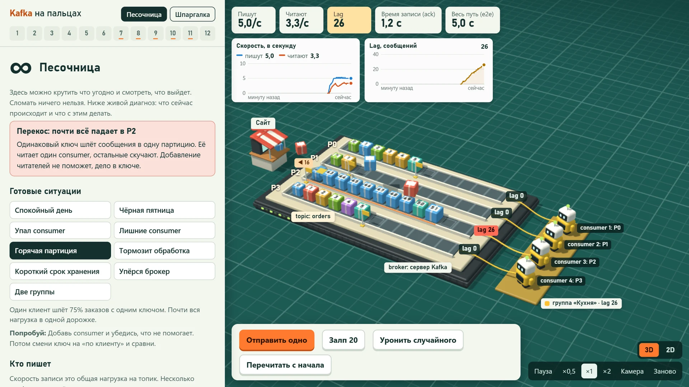</a><br><sub>Песочница: горячая партиция и диагноз, что с этим делать</sub></td>
</tr>
</table>

<details>
<summary>Ещё два</summary>
<br>

<table>
<tr>
<td width="50%" valign="top"><a href="docs/img/log.webp">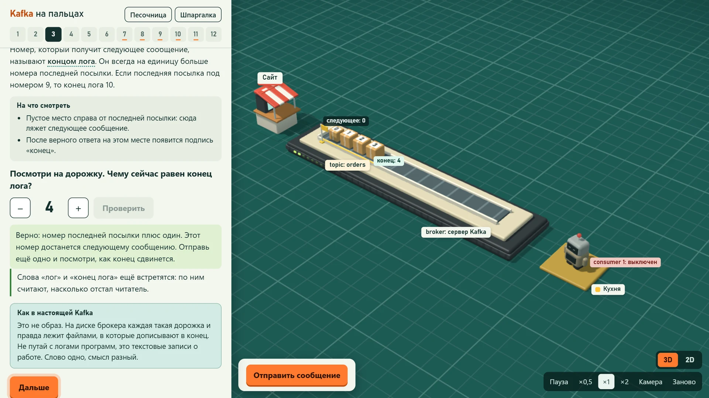</a><br><sub>Дорожка это лог: где у неё конец и какой номер получит следующее сообщение</sub></td>
<td width="50%" valign="top"><a href="docs/img/sheet.webp">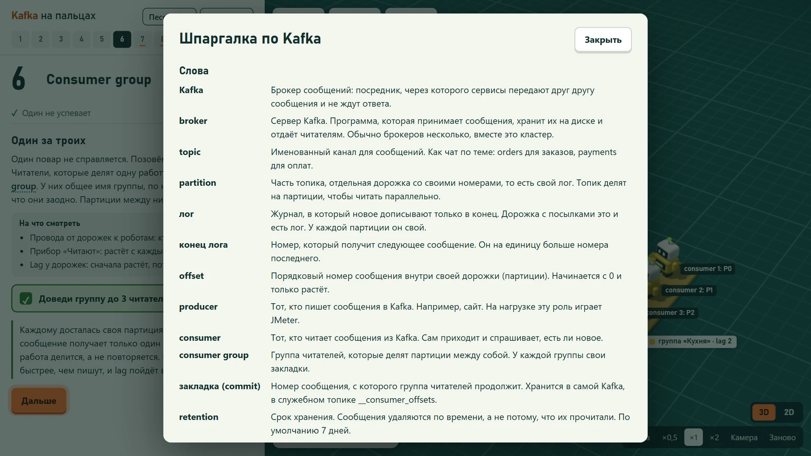</a><br><sub>Шпаргалка: слова, готовые фразы, формулы, что смотреть на нагрузке</sub></td>
</tr>
</table>

</details>

## 🧩 Что внутри

| | |
|---|---|
| 🪜 **12 ступеней, 71 шаг** | объяснение, на что смотреть, задание руками, вывод, «как в настоящей Kafka» |
| 🧊 **Две схемы** | 3D, которую можно крутить, и плоская 2D. Переключаются одной кнопкой на любом шаге |
| 🖐 **Всё кликается** | роботов можно ронять, закладку перетаскивать, скорость записи крутить ползунком |
| 🔨 **JMeter** | сборка скрипта, потоки с `.get()` и без, ступенчатый тест, поиск полки |
| ⏱ **Время всего пути** | метка `sentAt` в сообщении, поиск по ID, прикидка по lag |
| 🔥 **Босс** | 80 секунд «Чёрной пятницы»: пик, авария, план по мощности и три звезды |
| 🎤 **Мини-собес** | 14 вопросов, ответ своими словами и живой пример |
| 🧪 **Песочница** | 9 готовых ситуаций, полная свобода настроек и диагноз на ходу |
| 📋 **Шпаргалка** | словарик, готовые фразы, формулы, что смотреть на нагрузке |

## 🪜 Программа

🔥 важно для нагрузочного тестирования. Название ведёт сразу на ступень, «разбор» ведёт на текст с ответами.

| № | Ступень | О чём | НТ | |
|---|---|---|---|---|
| 1 | [Зачем нужна Kafka](https://mikhailshap.github.io/kafka-na-paltsah/#1) | зачем нужен посредник между сервисами |  | [разбор](docs/course.md#ступень-1-зачем-нужна-kafka) |
| 2 | [Кто есть кто](https://mikhailshap.github.io/kafka-na-paltsah/#2) | broker, topic, producer, consumer |  | [разбор](docs/course.md#ступень-2-кто-есть-кто) |
| 3 | [Offset и закладка](https://mikhailshap.github.io/kafka-na-paltsah/#3) | номера сообщений, лог, конец лога, закладка |  | [разбор](docs/course.md#ступень-3-offset-и-закладка) |
| 4 | [Чем Kafka не очередь](https://mikhailshap.github.io/kafka-na-paltsah/#4) | прочитанное не исчезает, срок хранения |  | [разбор](docs/course.md#ступень-4-чем-kafka-не-очередь) |
| 5 | [Партиции и ключ](https://mikhailshap.github.io/kafka-na-paltsah/#5) | как топик делят и кто решает, куда ляжет сообщение |  | [разбор](docs/course.md#ступень-5-партиции-и-ключ) |
| 6 | [Consumer group](https://mikhailshap.github.io/kafka-na-paltsah/#6) | как читатели делят работу, lag, rebalance |  | [разбор](docs/course.md#ступень-6-consumer-group) |
| 7 | [Потолок параллельности](https://mikhailshap.github.io/kafka-na-paltsah/#7) | почему лишние читатели спят | 🔥 | [разбор](docs/course.md#ступень-7-потолок-параллельности) |
| 8 | [Consumer lag](https://mikhailshap.github.io/kafka-na-paltsah/#8) | главная метрика: как считать, где смотреть, как найти полку | 🔥 | [разбор](docs/course.md#ступень-8-consumer-lag) |
| 9 | [Как подать нагрузку](https://mikhailshap.github.io/kafka-na-paltsah/#9) | JMeter: плагин или JSR223, цена `.get()`, ступенчатый тест | 🔥 | [разбор](docs/course.md#ступень-9-как-подать-нагрузку) |
| 10 | [Время отклика, которого не видно](https://mikhailshap.github.io/kafka-na-paltsah/#10) | ack и весь путь, `sentAt`, поиск по ID, кто упёрся | 🔥 | [разбор](docs/course.md#ступень-10-время-отклика-которого-не-видно) |
| 11 | [Чёрная пятница](https://mikhailshap.github.io/kafka-na-paltsah/#11) | босс: 80 секунд пика, авария и очередь | 🔥 | [разбор](docs/course.md#ступень-11-чёрная-пятница) |
| 12 | [Мини-собес по Kafka](https://mikhailshap.github.io/kafka-na-paltsah/#12) | 14 вопросов с разбором |  | [разбор](docs/course.md#ступень-12-мини-собес-по-kafka) |

## 🚀 Как запустить

**Без установки:** [mikhailshap.github.io/kafka-na-paltsah](https://mikhailshap.github.io/kafka-na-paltsah/)

**У себя:** скачай репозиторий и дважды кликни по `index.html`. Сервер, интернет и сборка не нужны.

```bash
git clone https://github.com/MikhailShap/kafka-na-paltsah.git
```

Подойдёт свежий Chrome, Edge или Firefox. Если нет WebGL2, курс откроется в 2D. Прогресс хранится в браузере.
Удобнее с компьютера: на узком экране подписи на схеме мелкие.

## 🔬 Насколько это похоже на настоящую Kafka

**Совпадает:**

- выбор партиции по ключу: `murmur2(ключ) % партиций`, 420 случаев из 420 совпали с Java-клиентом 3.9.2;
- раздача партиций внутри группы сверена с настоящим RangeAssignor на четырёх примерах;
- lag, конец лога, закладки, независимые группы, сроки хранения считаются по тем же правилам.

**Упрощено:** время растянуто до секунд, consumer берёт по одному сообщению, копий на других брокерах нет.
Полный список есть [в описании](docs/course.md#где-симулятор-упрощает) и в шпаргалке курса.

**Проверено:** 146 359 автоматических проверок модели и по 70 проверок прохождения в 2D и в 3D без ошибок.
Код с `sentAt` и поиском по ID запускался в JMeter 5.6.3. На живом брокере Kafka скрипты не запускались.

## 🗂 Как устроен проект

```
index.html          страница, с неё всё запускается
css/style.css       оформление
js/sim.js           модель Kafka, без графики
js/lessons.js       ступени, задания, вопросы, словарик
js/custom.js        особые шаги: скрипт JMeter, поиск по ID, босс, мини-собес
js/main.js          навигация, приборы, песочница, шпаргалка
js/ui.js            кнопки, графики, консоль, подсказки
js/gl.js            маленький 3D-движок на WebGL2
js/scene.js         схема в 3D
js/scene2d.js       схема в 2D
docs/course.md      полное описание каждого шага
trailer.mp4         трейлер
```

Сторонних библиотек нет. Тексты правятся в `js/lessons.js`.
