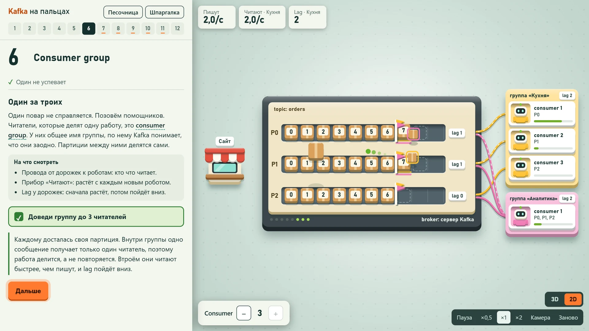
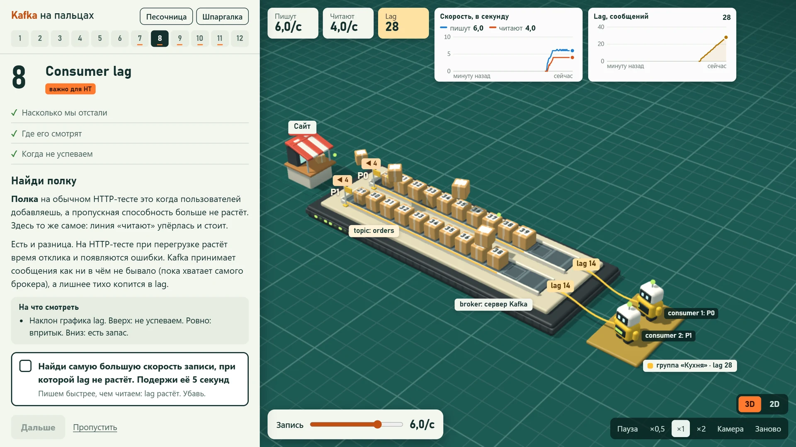
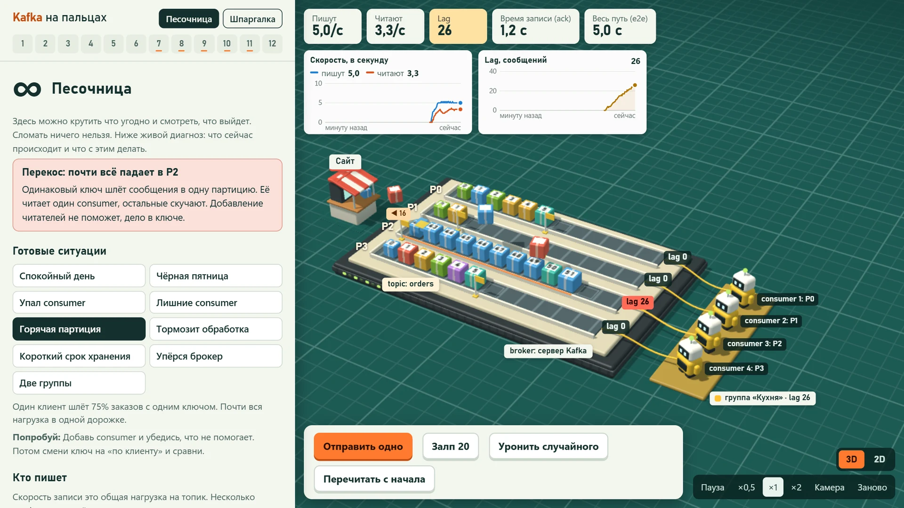

# Kafka на пальцах: полное описание

Здесь всё подробно: каждый шаг, задания, ответы, подсказки и устройство симулятора. Короткая страница со скриншотами: [README](../README.md).

> Осторожно, спойлеры: здесь есть ответы на все вопросы курса.

Интерактивный мини-курс по азам Kafka с симулятором. Объясняет простым языком, на примере пиццерии, с большим упором на то, чтобы всё потрогать руками. Сделан с уклоном в нагрузочное тестирование (НТ), в конце мини-собес на 14 вопросов.



**Трейлер:** [trailer.mp4](../trailer.mp4), чуть меньше двух минут, со звуком. Снят с настоящего курса.

## Коротко

| | |
|---|---|
| Ступеней | 12, внутри 71 шагов |
| Режимы схемы | 3D (объёмная, её можно крутить) и 2D (вид спереди, с толщиной и тенями) |
| Песочница | 9 готовых ситуаций и полная свобода настроек |
| Шпаргалка | слова, готовые фразы, формулы, что смотреть на нагрузке |
| Что нужно | только браузер. Без интернета, без установки, без сервера |

## Содержание

1. [Как запустить](#как-запустить)
2. [Как устроен экран](#как-устроен-экран)
3. [Что есть на схеме](#что-есть-на-схеме)
4. [Как устроен шаг](#как-устроен-шаг)
5. [Карта курса](#карта-курса)
   - [Ступень 1. Зачем нужна Kafka](#ступень-1-зачем-нужна-kafka)
   - [Ступень 2. Кто есть кто](#ступень-2-кто-есть-кто)
   - [Ступень 3. Offset и закладка](#ступень-3-offset-и-закладка)
   - [Ступень 4. Чем Kafka не очередь](#ступень-4-чем-kafka-не-очередь)
   - [Ступень 5. Партиции и ключ](#ступень-5-партиции-и-ключ)
   - [Ступень 6. Consumer group](#ступень-6-consumer-group)
   - [Ступень 7. Потолок параллельности](#ступень-7-потолок-параллельности)
   - [Ступень 8. Consumer lag](#ступень-8-consumer-lag)
   - [Ступень 9. Как подать нагрузку](#ступень-9-как-подать-нагрузку)
   - [Ступень 10. Время отклика, которого не видно](#ступень-10-время-отклика-которого-не-видно)
   - [Ступень 11. Чёрная пятница](#ступень-11-чёрная-пятница)
   - [Ступень 12. Мини-собес по Kafka](#ступень-12-мини-собес-по-kafka)
6. [Песочница](#песочница)
7. [Шпаргалка](#шпаргалка)
8. [Словарик](#словарик)
9. [Надписи и подсказки на схеме](#надписи-и-подсказки-на-схеме)
10. [Как работает симулятор](#как-работает-симулятор)
11. [Файлы проекта](#файлы-проекта)
12. [Что проверено и чего нет](#что-проверено-и-чего-нет)
13. [Источники](#источники)

## Как запустить

Дважды кликни по `index.html`. Страница откроется в браузере, сервер не нужен.

- Без установки: [курс открывается прямо в браузере](https://mikhailshap.github.io/kafka-na-paltsah/).
- Подойдёт свежий Chrome, Edge или Firefox. Если браузер не включит WebGL2, курс откроется сразу в 2D, а кнопка 3D станет неактивной с подсказкой «Браузер не включил WebGL2, 3D недоступно».
- Открыть нужную ступень сразу можно ссылкой с номером: `index.html#8`. Песочницу: `index.html#sandbox`.
- Прогресс и выбранный режим схемы хранятся в этом браузере. Чтобы начать с нуля, удали данные сайта или в консоли браузера выполни `localStorage.removeItem('kafka-na-paltsah')`.
- После изменения файлов обновляй страницу через Ctrl+F5.

## Как устроен экран



**Слева панель урока.**

- Сверху название «Kafka на пальцах» (клик возвращает на первую ступень) и кнопки «Песочница» и «Шпаргалка».
- Под ними 12 номеров ступеней. Чёрный это текущая, зелёные пройдены, оранжевая чёрточка значит «важно для НТ». Прыгать можно в любую, ничего не заблокировано.
- Дальше текст шага: объяснение, «На что смотреть», задание, вывод.
- Пройденные шаги сворачиваются в список с галочками, их можно раскрыть и перечитать.
- Кнопка «Дальше» загорается после выполнения задания. Рядом «Пропустить», она никогда ничего не ломает: следующий шаг сам подготовит схему. На последнем шаге кнопка называется «Следующая ступень», а в самом конце «В песочницу».
- Подчёркнутые пунктиром слова показывают определение при наведении.

**Справа схема.**

- Сверху приборы: «Пишут», «Читают», «Lag» и другие, набор зависит от шага. «Lag» желтеет после 8 и краснеет после 30.
- Рядом два графика за последнюю минуту: «Скорость, в секунду» и «Lag, сообщений» (в ступени 10 и в песочнице бывает третий, «Время записи (ack), секунд»), слева «минуту назад», справа «сейчас». Наведи мышь, и появится точное значение.
- В ступени 8 и в песочнице есть «консоль» с выводом `kafka-consumer-groups.sh`.
- Снизу слева кнопки и ползунки текущего шага.
- Над ними лента событий: короткие фразы о том, что сейчас произошло.
- Снизу справа переключатель **3D / 2D**, «Пауза» (потом «Пуск»), скорость времени ×0,5, ×1, ×2, «Камера» (вернуть вид на место) и «Заново» (начать ступень сначала).

**Мышь.** Клик по киоску отправляет сообщение (в ступени 1 до Kafka делает заказ). Клик по роботу выключает или включает его. Флажок можно перетащить. В 3D схему вращают, зажав кнопку на фоне, в 2D фон так же тянут. Колёсико приближает, двойной клик по фону возвращает вид. Наведение на любую деталь показывает подсказку.

## Что есть на схеме

| Деталь | Что это в Kafka | Как ведёт себя |
|---|---|---|
| Киоск «Сайт» | producer | Бросает посылки в топик. Экран становится оранжевым, когда сайт ждёт ответа |
| Пушка «JMeter» | producer под нагрузкой | То же самое, только пушка |
| Тёмный корпус с лампочками | broker | Лампочки мигают, когда идут сообщения |
| Светлый поддон | topic | Внутри лежат дорожки |
| Дорожка P0, P1… | партиция, она же лог | Имена P0, P1 появляются, когда дорожек несколько. Видна часть лога: 12 ячеек в 3D и 10 в 2D, дальше лента уезжает влево |
| Посылка с номером | сообщение и его offset | Цвет это ключ (клиент). Без ключа картонная |
| Пунктирное место | конец лога, сюда ляжет следующее сообщение | В ступенях 3, 5 и 8 там подпись «конец: N» |
| Красная черта | новое начало лога | Появляется, когда старое удалили по сроку |
| Флажок | закладка группы (commit) | Стоит перед следующим непрочитанным. «◀ 14» (на одной дорожке «отстал: ещё 14 слева») значит, что ещё 14 непрочитанных не поместились на экран |
| Цветная лента под посылками | непрочитанное, то есть lag | Чем больше lag, тем краснее |
| Зелёный огонёк | ack | Летит к producer: «записал» |
| Копия в цветной рамке | чтение | Летит к роботу, оригинал остаётся |
| Провод | какую партицию кто читает | Когда идёт чтение, в 3D светится, а в 2D по нему бежит пунктир |
| Площадка с роботами | consumer group | Жёлтая «Кухня», синяя «СМС», розовая «Аналитика» |
| Жёлтая посылка «твой заказ» | меченое сообщение | Есть только в ступени 10 |

**Состояния робота:**

- **читает** или список партиций: работает, идёт полоска обработки;
- **ждёт новых**: всё прочитано;
- **спит**: партиции не досталось;
- **ждёт раздачу**: идёт rebalance;
- **не отвечает**: упал, группа ещё не заметила;
- **выключен**: не работает. На маленьких карточках короче: «выкл».

## Как устроен шаг

Почти каждый шаг состоит из одних и тех же частей. Так же они описаны ниже в этом файле.

1. **Объяснение.** Что это и зачем.
2. **На что смотреть.** За чем следить на схеме.
3. **Задание.** Что сделать руками. Выполнение курс проверяет сам.
4. **Вывод.** Появляется после выполнения.
5. **Как в настоящей Kafka.** Чем жизнь отличается от симулятора.

Ещё бывают вопросы с вариантами (ошибаться можно, каждый неверный ответ объясняется), вопросы с числом, задание «найди на схеме» и особые шаги. В конце ступени итог «Что запомнить» и фраза «Как ответить на собесе», сыпется конфетти. Ступень отмечается пройденной, когда дошёл до итога, даже если часть шагов пропустил.

## Карта курса

| № | Ступень | Шагов | Новые слова | НТ |
|---|---|---|---|---|
| 1 | [Зачем нужна Kafka](#ступень-1-зачем-нужна-kafka) | 7 | Kafka, синхронно, асинхронно |  |
| 2 | [Кто есть кто](#ступень-2-кто-есть-кто) | 6 | broker, topic, producer, consumer |  |
| 3 | [Offset и закладка](#ступень-3-offset-и-закладка) | 7 | offset, лог, конец лога, закладка (commit) |  |
| 4 | [Чем Kafka не очередь](#ступень-4-чем-kafka-не-очередь) | 6 | retention |  |
| 5 | [Партиции и ключ](#ступень-5-партиции-и-ключ) | 7 | partition, ключ |  |
| 6 | [Consumer group](#ступень-6-consumer-group) | 7 | consumer group, consumer lag, rebalance |  |
| 7 | [Потолок параллельности](#ступень-7-потолок-параллельности) | 5 | partition, consumer, consumer lag | да |
| 8 | [Consumer lag](#ступень-8-consumer-lag) | 7 | consumer lag | да |
| 9 | [Как подать нагрузку](#ступень-9-как-подать-нагрузку) | 7 | JSR223, ack, producer | да |
| 10 | [Время отклика, которого не видно](#ступень-10-время-отклика-которого-не-видно) | 9 | ack, end-to-end, sentAt | да |
| 11 | [Чёрная пятница](#ступень-11-чёрная-пятница) | 2 | consumer lag, partition, consumer group | да |
| 12 | [Мини-собес по Kafka](#ступень-12-мини-собес-по-kafka) | 1 | проверка всего |  |

---

## Ступень 1. Зачем нужна Kafka

Начнём с проблемы, которую решает Kafka. Сначала поработаем без неё и посмотрим, где болит. Потом поставим Kafka и сравним.

**Детали этой ступени:** Kafka, синхронно, асинхронно.

### 1.1. Сайт звонит всем по очереди

Это пиццерия. Клиент нажал на сайте «Заказать». О заказе должны узнать три сервиса: **кухня** готовит пиццу, **СМС-рассылка** пишет клиенту, **аналитика** считает выручку.

Kafka пока нет. Сайт обращается к каждому сервису сам: отправил запрос, дождался ответа, пошёл к следующему. На проектах это обычно HTTP-вызовы.

**На что смотреть**

- Посылка едет от сайта к сервису: это запрос.
- Зелёный огонёк едет обратно: это ответ.
- Над сайтом тикает таймер: столько ждёт клиент.

**Задание:** Сделай заказ и досмотри до конца.

*Подсказка:* Жми кнопку снизу или прямо на киоск «Сайт».

**Что происходит.** Слева киоск «Сайт», справа три робота: жёлтый «Кухня», синий «СМС», розовый «Аналитика». Kafka нет, от сайта к каждому сервису идёт прямая линия. После нажатия посылка по очереди едет к каждому: 0,6 с туда, 0,9 с обработка, 0,6 с обратно. Активная линия светится, экран киоска становится оранжевым, над сайтом тикает «клиент ждёт N с». Три раза по 2,1 с дают примерно 6,3 с. В конце над сайтом появляется, за сколько принят заказ.

**Кнопки снизу:** «Сделать заказ».

**Засчитается, когда** хотя бы один заказ дошёл до конца.

**Вывод.** Клиент ждал больше 6 секунд: время трёх сервисов сложилось. Хотя человеку достаточно было услышать «заказ принят».

> **Как в настоящей Kafka.** Секунды здесь растянуты, чтобы было видно. В жизни это десятки и сотни миллисекунд, но складываются они так же. Вызовы можно делать и параллельно, тогда клиент ждёт самого медленного. Сама зависимость никуда не денется.

### 1.2. Один сломался, встали все

Теперь представь, что СМС-рассылка упала: сервер перезагрузили или у оператора авария.

К пицце СМС отношения не имеет. Проверим, переживёт ли это заказ.

**На что смотреть**

- Запрос к СМС уходит, но ответа нет.
- Таймер над сайтом продолжает тикать, пока сайт не сдастся.

**Задание:** Выключи СМС и попробуй оформить заказ.

1. Кликни по синему роботу (или по переключателю «СМС» снизу).
2. Сделай заказ.
3. Дождись, чем закончится.

*Подсказка меняется по ходу:* «Сломался сервис «…». Нужна именно СМС-рассылка, остальные включи обратно.»

**Что происходит.** Выключенный робот сереет, подпись «не работает». Заказ проходит кухню, доезжает до СМС и зависает: рядом с роботом «нет ответа…», сайт ждёт 3,5 секунды. Потом над сайтом появляется надпись, что заказ не оформлен. До аналитики дело не доходит.

**Кнопки снизу:** «Сделать заказ», переключатель «СМС».

**Засчитается, когда** заказ упал именно на СМС-рассылке. Если сломать другой сервис, шаг не засчитается.

**Вывод.** Сайт прождал до своего таймаута и показал ошибку. Кухня заказ уже получила, а аналитика о нём даже не узнала: до неё очередь не дошла. Получилась каша.

### 1.3. Ставим посредника

Такая связь называется *синхронной*: отправил и стоишь, пока не ответят. Как телефонный звонок: если собеседник не берёт трубку, разговора нет.

Нам нужно по-другому, как с почтовым ящиком: опустил письмо и пошёл по делам, а адресат заберёт, когда сможет. Такой ящик между сервисами и есть *Kafka*. Её называют **брокером сообщений**, то есть посредником.

**На что смотреть**

- Между сайтом и сервисами появится тёмный блок: это сервер Kafka.
- Прямые линии от сайта к сервисам пропадут. Теперь сервисы связаны только с Kafka.
- На подписи topic и broker пока не отвлекайся, эти слова разберём в ступени 2.

**Задание:** Поставь Kafka между сервисами.

**Что происходит.** Сверху падает брокер с топиком `orders` и одной дорожкой. Сайт отъезжает влево, сервисы становятся тремя отдельными группами по одному читателю, каждый со скоростью 1,6 сообщения в секунду. Выключенный СМС остаётся выключенным.

**Кнопки снизу:** «Поставить Kafka».

**Засчитается, когда** Kafka поставлена.

**Вывод.** Сайт больше не знает, кто и когда прочитает заказ. Он знает только про Kafka. Завтра можно подключить четвёртый сервис, и сайт менять не придётся.

### 1.4. Положил и пошёл дальше

Теперь сайт делает одно действие: кладёт сообщение в Kafka. Как только Kafka ответила «записала», сайт говорит клиенту «заказ принят».

Это *асинхронная* связь. Кухня, СМС и аналитика забирают сообщение сами, каждый в своём темпе. СМС всё ещё выключен, и это нарочно.

**На что смотреть**

- Сколько теперь ждёт клиент: надпись над сайтом.
- Кухня и аналитика работают, хотя СМС лежит.

**Задание:** Оформи 3 заказа.

**Что происходит.** Посылка летит на дорожку 0,75 с и получает номер, зелёный огонёк (ack) возвращается за 0,45 с. Над сайтом надпись «заказ принят за 1,2 с». Кухня и аналитика забирают копии, их флажки едут вправо. Синий флажок СМС стоит, под посылками растёт синяя лента непрочитанного. Кухню и аналитику шаг включает сам, СМС нарочно оставляет выключенным.

**Кнопки снизу:** «Сделать заказ».

**Засчитается, когда** записано 3 новых сообщения, кухня и аналитика прочитали всё.

**Вывод.** Клиент получает ответ примерно за секунду вместо шести. И поломка СМС ему не мешает.

> **Как в настоящей Kafka.** Одно ожидание всё же осталось: сайт ждёт подтверждение от Kafka. Обычно это миллисекунды. Если ляжет сама Kafka, сайт это почувствует, поэтому на проектах ставят несколько брокеров.

### 1.5. СМС проснулся

Что стало с СМС-сообщениями, пока рассылка лежала? Они спокойно лежат в Kafka.

Флажки на дорожке показывают, где остановился каждый сервис. Синий флажок СМС отстал от остальных.

**На что смотреть**

- Синий флажок едет вправо, догоняя жёлтый и розовый.
- Сообщения при этом остаются на дорожке.

**Задание:** Включи СМС, пусть догоняет.

**Что происходит.** Если СМС уже успел догнать, шаг сам выключит его и положит 3 сообщения, чтобы было что догонять. После включения короткая пауза (группа делит партиции), потом синий робот читает подряд с того места, где стоял флажок.

**Кнопки снизу:** переключатель «СМС», «Сделать заказ».

**Засчитается, когда** СМС включён и прочитал всё.

**Вывод.** СМС дочитал всё накопившееся с того места, где остановился. Ни одно сообщение не потерялось, хотя сервис лежал.

> **Как в настоящей Kafka.** Ждать вечно сообщения не будут, у них есть срок хранения (по умолчанию 7 дней). Об этом ступень 4.

### 1.6. Вопрос

Проверь себя. Можно ошибаться, под каждым неверным ответом будет объяснение.

**Что меняется, когда между сервисами стоит Kafka?**

- ✅ **Отправитель не ждёт, пока все обработают сообщение.** Верно. Сайт записал сообщение и свободен. Сервисы при этом работают с той же скоростью, просто их никто не ждёт.
- ❌ **Сервисы начинают работать быстрее.** Скорость самих сервисов не меняется: кухня готовит пиццу так же. Меняется то, что сайт её не ждёт.
- ❌ **Сервисам больше нельзя падать.** Наоборот: падать теперь не так страшно. Упавший сервис поднимется и дочитает.

### 1.7. Что запомнить

- **Kafka** это брокер сообщений, посредник между сервисами.
- Сервисы общаются **асинхронно**: отправил и пошёл дальше.
- Если один сервис упал, остальные работают. Упавший потом дочитает.
- Отправитель не знает, кто его читает. Новых читателей можно добавлять, не трогая его.

> **Как ответить на собесе:** Kafka это брокер сообщений. Через неё сервисы общаются асинхронно: один записал сообщение, а остальные прочитают, когда смогут, и никто никого не ждёт.

---

## Ступень 2. Кто есть кто

Соберём Kafka с нуля, по одной детали. Деталей всего четыре, и именно эти слова звучат в любом разговоре про Kafka.

**Детали этой ступени:** broker, topic, producer, consumer.

### 2.1. Broker: сам сервер

Первая деталь это *broker*. Звучит важно, а на деле это просто сервер: программа, запущенная на машине.

Она делает три вещи: принимает сообщения, хранит их у себя на диске и отдаёт тем, кто приходит читать.

**На что смотреть**

- Тёмный корпус с лампочками. Лампочки мигают, когда идут сообщения.

**Задание:** Поставь broker.

**Что происходит.** Стол пустой. По кнопке сверху падает тёмный корпус с лампочками. Горят две: трафика пока нет.

**Кнопки снизу:** «Поставить broker».

**Засчитается, когда** брокер поставлен.

**Вывод.** Сервер стоит, но он пустой. Класть сообщения пока некуда.

> **Как в настоящей Kafka.** На проектах брокеров обычно три и больше, вместе они называются кластером. Если один упадёт, остальные держат копии данных. Внутренности этого нам не нужны, хватит слова «кластер».

### 2.2. Topic: канал по теме

Сообщения не валят в одну кучу. Для каждой темы заводят *topic*. Это как отдельный чат или папка: в `orders` только заказы, в `payments` только оплаты.

Кто пишет и кто читает, договариваются об имени топика. По имени они и находят друг друга.

**На что смотреть**

- Светлый поддон на брокере: это топик.
- Дорожка внутри него: сюда будут ложиться сообщения. Пунктиром отмечено место для следующего.

**Задание:** Создай топик orders.

**Что происходит.** На корпус ложится светлый поддон с подписью «topic: orders» и одной дорожкой. Пунктиром отмечено место для сообщения с offset 0.

**Кнопки снизу:** «Создать топик orders».

**Засчитается, когда** топик создан.

**Вывод.** Топик готов. Теперь нужен тот, кто будет в него писать.

### 2.3. Producer: тот, кто пишет

*Producer* пишет сообщения в топик. У нас это сайт пиццерии, и каждый заказ становится одним сообщением.

Сообщение это небольшой кусок данных, чаще всего текст в JSON, например `{"order": 17, "pizza": "Маргарита"}`.

**На что смотреть**

- Посылка летит на дорожку и получает номер на крышке.
- Обратно к киоску летит зелёный огонёк.

**Задание:** Подключи producer и отправь 3 сообщения.

1. Нажми «Подключить producer».
2. Отправь 3 сообщения кнопкой или кликами по киоску.

**Что происходит.** Слева появляется киоск. Каждая отправка: посылка летит дугой, ложится в конец дорожки и получает номер 0, 1, 2. Лампочки брокера мигают, к киоску возвращается зелёный огонёк.

**Кнопки снизу:** «Подключить producer», «Отправить сообщение».

**Засчитается, когда** записано не меньше 3 сообщений.

**Вывод.** Зелёный огонёк это *ack*: Kafka говорит «записала». Заметь, их ещё никто не прочитал, а ack уже пришёл.

### 2.4. Consumer: тот, кто читает

*Consumer* читает сообщения из топика. Важная деталь: Kafka никому ничего не проталкивает. Consumer сам приходит и спрашивает: «Есть что новое?» Если нет, спросит ещё раз.

Поэтому читатель не захлебнётся: берёт столько, сколько успевает обработать.

**На что смотреть**

- К роботу летит копия сообщения в цветной рамке.
- Сама посылка остаётся лежать на дорожке.

**Задание:** Подключи consumer и дождись, пока он всё прочитает.

**Что происходит.** Справа появляется площадка «Кухня» с роботом. Он читает с offset 0, скорость 1,6 сообщения в секунду. К нему летят копии в цветной рамке, у робота растёт полоска обработки, жёлтый флажок едет вправо.

**Кнопки снизу:** «Подключить consumer», «Отправить сообщение».

**Засчитается, когда** прочитано не меньше 3 сообщений и непрочитанных не осталось.

**Вывод.** Прочитано всё, а посылки на месте. Это главное отличие Kafka от обычной очереди, к нему вернёмся в ступени 4.

> **Как в настоящей Kafka.** Настоящий consumer забирает не по одному сообщению, а сразу пачкой (по умолчанию до 500 за раз), а потом обрабатывает её. Здесь по одному, чтобы успевать следить.

### 2.5. Покажи на схеме

Проверим, запомнил ли ты, кто есть кто. Читай подсказку и кликай по нужной детали прямо на схеме.

1. Кликни по тому, кто **пишет** сообщения. Верно: producer.
2. Кликни по тому, кто **читает** сообщения. Верно: consumer.
3. Кликни по **каналу** с сообщениями. Верно: topic.
4. Кликни по **серверу**, на котором всё это лежит. Верно: broker.

**Что происходит.** Подсказки при наведении на этом шаге отключены, чтобы не подсматривать. Верная деталь отмечается галочкой. На неверную лента отвечает «Нет, это другое: …» и называет, по чему ты кликнул. Топиком считаются и поддон, и дорожка, и сообщение. Читателем считаются и робот, и площадка группы.

**Засчитается, когда** найдены все четыре детали.

**Вывод.** Все четыре детали на месте. Путь сообщения всегда такой: producer, топик на брокере, consumer.

### 2.6. Что запомнить

- **Broker**: сервер Kafka, хранит сообщения. Несколько брокеров это кластер.
- **Topic**: канал с названием, по одной теме.
- **Producer** пишет в топик и получает ack.
- **Consumer** сам приходит за сообщениями и читает копию.

> **Как ответить на собесе:** Producer пишет сообщение в топик на брокере, а consumer сам приходит и читает из топика.

---

## Ступень 3. Offset и закладка

Раз сообщения не исчезают после чтения, читателю надо помнить, что он уже видел. Для этого есть номера и закладки.

**Детали этой ступени:** offset, лог, конец лога, закладка (commit).

### 3.1. У каждого сообщения есть номер

Номер сообщения называется *offset*. Он написан на крышке посылки. Счёт идёт с нуля: 0, 1, 2, 3 и так далее.

Номер выдаёт Kafka в момент записи. Он не меняется и не переиспользуется: даже если сообщение потом удалят, его номер никому не достанется.

**На что смотреть**

- Новые посылки всегда ложатся в конец, справа.
- Первая посылка получает номер 0, а не 1.

**Задание:** Отправь 4 сообщения и кликни по тому, у которого offset 2.

*Подсказка:* Это третья посылка слева. Кликай прямо по ней.

*Подсказка меняется по ходу:* «Нашёл. Осталось довести число сообщений до четырёх.» / «Это offset N. Нужен 2.»

**Что происходит.** Consumer выключен, посылки просто копятся. Больше 8 сообщений до выполнения отправить не получится, чтобы нужная посылка не уехала за край дорожки.

**Кнопки снизу:** «Отправить сообщение».

**Засчитается, когда** записано не меньше 4 сообщений и ты кликнул по offset 2.

**Вывод.** Третье по счёту сообщение имеет offset 2. Легко запутаться на один, поэтому помни: счёт с нуля.

### 3.2. Дорожка это лог

Ты видел: новая посылка всегда ложится в конец. Kafka не вставляет сообщения в середину и не переписывает старые, она только дописывает. Журнал, в который только дописывают в конец, называют ***лог***. Дорожка перед тобой это и есть лог.

Номер, который получит следующее сообщение, называют ***концом лога***. Он всегда на единицу больше номера последней посылки. Если последняя посылка под номером 9, то конец лога 10.

**На что смотреть**

- Пустое место справа от последней посылки: сюда ляжет следующее сообщение.
- После верного ответа на этом месте появится подпись «конец».

**Посмотри на дорожку. Чему сейчас равен конец лога?**

- Ответ: номер последней посылки плюс один, считается на лету (выбирается кнопками от 0 до 30, потом «Проверить»)
- После верного ответа: «Верно: номер последней посылки плюс один. Этот номер достанется следующему сообщению. Отправь ещё одно и посмотри, как конец сдвинется.»
- После неверного: «Не сходится. Найди номер последней посылки и прибавь 1.»

**Что происходит.** Consumer выключен. Если на дорожке меньше четырёх посылок, шаг докладывает недостающие. После верного ответа на пустом месте справа появляется подпись «конец: N» (в 2D она внутри пунктирной рамки) и остаётся до конца ступени. Можно отправить ещё сообщение и увидеть, как число растёт на единицу. Больше 8 сообщений до ответа отправить нельзя.

**Кнопки снизу:** «Отправить сообщение».

**Засчитается, когда** введён номер последней посылки плюс один.

**Вывод.** Слова «лог» и «конец лога» ещё встретятся: по ним считают, насколько отстал читатель.

> **Как в настоящей Kafka.** Это не образ. На диске брокера каждая такая дорожка и правда лежит файлами, в которые дописывают в конец. Не путай с логами программ, это текстовые записи о работе. Слово одно, смысл разный.

### 3.3. Закладка читателя

Жёлтый флажок это *закладка*. Как в книге: она показывает, с какого сообщения читать дальше.

Прочитал и обработал сообщение, передвинул закладку на следующее. Закладку двигает сам читатель, Kafka её только хранит.

Читателей одного сервиса называют **группой**, закладка у группы общая. В группе «Кухня» пока один робот, а большие группы будут в ступени 6.

**На что смотреть**

- Флажок стоит перед сообщением, которое прочитают следующим.
- Жёлтая лента под посылками: всё, что ещё не прочитано.
- Полоска на роботе: он обрабатывает сообщение.

**Задание:** Включи consumer и посмотри, как едет флажок.

*Подсказка:* Клик по роботу или переключатель снизу.

**Что происходит.** Шаг выключает consumer и, если непрочитанных меньше трёх, докладывает 4 сообщения. После включения робот читает со скоростью 1,4 в секунду. На каждом сообщении копия летит к роботу, идёт полоска обработки, флажок перескакивает на следующий номер. Подпись у флажка: «следующее: N», а в конце «прочитано всё».

**Кнопки снизу:** переключатель «Consumer», «Отправить сообщение».

**Засчитается, когда** consumer включён и прочитал всё.

**Вывод.** Флажок доехал до конца лога: непрочитанного нет. Посылки на месте, сдвинулась только закладка.

> **Как в настоящей Kafka.** Закладка хранится в самой Kafka, в служебном топике `__consumer_offsets`. Сдвиг закладки называется commit.

### 3.4. Упал и вернулся

Сервисы падают и перезапускаются, это нормально. Что будет с чтением?

Проверь: останови читателя, накопи сообщений и верни его в строй.

**На что смотреть**

- Пока consumer выключен, флажок стоит на месте.
- После включения чтение начнётся ровно с флажка.

**Задание:** Останови consumer и верни его.

1. Выключи consumer.
2. Отправь 4 сообщения.
3. Включи обратно и дождись, пока догонит.

**Что происходит.** При выключении робот сереет, флажок замирает. Если выключить посреди обработки, лента предупредит, что это сообщение обработают ещё раз. После включения пауза 0,7 с на раздачу партиций, потом чтение идёт ровно с флажка.

**Кнопки снизу:** переключатель «Consumer», «Отправить сообщение».

**Засчитается, когда** consumer был выключен, за это время накопилось 4 непрочитанных, потом его включили и он догнал.

**Вывод.** Продолжил с закладки: ничего не пропустил и не начал сначала.

> **Как в настоящей Kafka.** Здесь закладка сдвигается после каждого сообщения. В настоящей Kafka по умолчанию она сохраняется сама раз в 5 секунд. Поэтому после падения последние сообщения могут обработать **второй раз**. Это нормально, и сервисы должны быть к этому готовы.

### 3.5. Перемотай назад

Сообщения после чтения не исчезли. Значит, их можно прочитать ещё раз: нужно просто переставить закладку назад.

Так делают, когда в обработке нашли ошибку. Поправили код, отмотали назад и прогнали те же данные заново.

**На что смотреть**

- Пока переставляешь, группа на миг останавливается.
- Потом consumer заново проходит по тем же посылкам.

**Задание:** Перетащи жёлтый флажок влево, на offset 0 или 1.

*Подсказка:* Хватай за флажок мышкой и тяни. Или нажми кнопку снизу.

**Что происходит.** Пока тянешь флажок, рядом надпись «поставить на N». Когда отпускаешь, группа встаёт примерно на секунду, потом робот проходит по тем же посылкам второй раз.

**Кнопки снизу:** «Вернуть закладку на 0», «Отправить сообщение».

**Засчитается, когда** закладка сдвинута назад на 0 или 1 и всё перечитано до конца.

**Вывод.** Всё прочитано второй раз. В обычной очереди так не выйдет: там прочитанное уже удалено.

> **Как в настоящей Kafka.** В жизни это делают командой `kafka-consumer-groups.sh --reset-offsets`. Читателей группы перед этим останавливают, на живой группе команда откажет.

### 3.6. Вопрос

**Consumer обработал сообщения с 0 по 4, сдвинул закладку и упал. Откуда он продолжит?**

- ✅ **С offset 5.** Верно. Обработаны 0, 1, 2, 3, 4, значит закладка стоит на 5: это следующее непрочитанное.
- ❌ **С offset 0, заново.** Сначала он начнёт, только если закладку нарочно вернут на 0. Сама по себе она не сбрасывается.
- ❌ **С самого свежего сообщения.** Тогда пропали бы все сообщения между 5 и самым свежим. Закладка нужна как раз, чтобы этого не случилось.

### 3.7. Что запомнить

- **Offset**: номер сообщения, начинается с 0, выдаётся один раз и навсегда.
- **Лог**: журнал, куда только дописывают в конец. Дорожка с посылками это и есть лог.
- **Конец лога**: номер, который получит следующее сообщение.
- Читатель помнит, где остановился: это его **закладка** (commit).
- После падения продолжают с закладки. Последние сообщения могут обработать дважды.
- Закладку можно сдвинуть назад и перечитать.
- Такую дорожку в Kafka называют **партицией**. Зачем их бывает несколько, узнаешь в ступени 5.

> **Как ответить на собесе:** Offset это номер сообщения в партиции. Группа сохраняет свой offset, поэтому после падения продолжает с того же места, а при желании может перечитать старое.

---

## Ступень 4. Чем Kafka не очередь

Самый частый вопрос про Kafka: «Это же просто очередь?» Нет. Поставим рядом обычную очередь и Kafka и посмотрим на разницу.

**Детали этой ступени:** retention.

### 4.1. Два способа хранить

Сверху обычная очередь, такие бывают, например, в RabbitMQ. Снизу Kafka. Сайт кладёт одинаковые заказы и туда, и туда.

Читатели пока выключены, поэтому разницы ещё не видно.

**На что смотреть**

- Одно нажатие отправляет сразу две одинаковые посылки: в верхнюю и в нижнюю дорожку.

**Задание:** Отправь 5 заказов.

**Что происходит.** Сверху серый поддон «обычная очередь», снизу светлый «Kafka». Одно нажатие отправляет две одинаковые посылки, по одной в каждую дорожку. Справа две площадки: «Кухня, очередь» и «Кухня, Kafka», читатели выключены. Слишком много отправить до выполнения шага нельзя.

**Кнопки снизу:** «Отправить сообщение», «Отправить 5».

**Засчитается, когда** в Kafka записано 5 сообщений.

**Вывод.** Пока обе дорожки выглядят одинаково. Разница начнётся, когда придут читатели.

### 4.2. Читаем

Теперь пусть кухня прочитает заказы. Одна кухня читает из очереди, другая из Kafka.

**На что смотреть**

- Сверху улетает сама посылка, и место пустеет.
- Снизу улетает копия, а посылка остаётся. Двигается только флажок.

**Задание:** Включи читателей и дождись конца.

**Что происходит.** Из очереди к роботу улетает сама посылка, дорожка пустеет. Из Kafka летит копия, посылка остаётся, едет флажок. Обе кухни читают со скоростью 1,4 в секунду.

**Кнопки снизу:** «Включить читателей».

**Засчитается, когда** читатели включены, очередь пуста, в Kafka непрочитанного нет.

**Вывод.** Очередь опустела: прочитал, значит забрал. В Kafka все сообщения на месте, сдвинулась только закладка.

### 4.3. Пришёл новый читатель

Прошла неделя, в компании появилась **аналитика**. Она хочет посчитать все заказы с самого начала.

Подключим её и к очереди, и к Kafka.

**На что смотреть**

- Есть ли что читать розовому роботу сверху.
- Откуда начинает розовый робот снизу. У него свой флажок.

**Задание:** Подключи аналитику к обеим дорожкам.

**Что происходит.** Шаг опустошает очередь и следит, чтобы в Kafka лежало не меньше 5 сообщений. Появляются две розовые площадки: «Аналитика, очередь» и «Аналитика, Kafka». Верхней читать нечего, она пишет «ждёт новых». Нижняя читает с offset 0, рядом с жёлтым флажком появляется розовый. Скорость аналитики 1,8 в секунду.

**Кнопки снизу:** «Подключить аналитику».

**Засчитается, когда** аналитика прочитала из Kafka 5 сообщений.

**Вывод.** Из очереди читать нечего: кухня уже всё забрала. Из Kafka аналитика взяла всё с нулевого сообщения и никому не помешала.

> **Как в настоящей Kafka.** Читать с самого начала это настройка группы (`auto.offset.reset=earliest`). По умолчанию новая группа видит только **новые** сообщения, старые она пропускает. В нашем симуляторе группы настроены читать с начала.

### 4.4. Срок годности

Вечно сообщения тоже не лежат, иначе кончится диск. У топика есть срок хранения, *retention*. По умолчанию это **7 дней**.

Удаляется всё старое: и прочитанное, и непрочитанное. Чтение тут вообще ни при чём.

**На что смотреть**

- Сайт сам отправляет заказы.
- Старые посылки темнеют, отрываются и исчезают слева.
- Красная черта: отсюда теперь начинается лог. Всё, что было левее, удалено.

**Задание:** Поставь срок хранения 6 секунд и дождись, пока исчезнут 4 сообщения.

*Подсказка меняется по ходу:* «Исчезло: N из 4»

**Что происходит.** Сайт сам пишет 0,8 сообщения в секунду, теперь только в Kafka. Ползунок «Хранить» ходит от 4 до 60 секунд. За 2,5 секунды до конца срока посылка темнеет, потом отрывается от дорожки и исчезает. Красная черта показывает новое начало лога. Если флажок указывал на удалённое, он перескакивает на начало.

**Кнопки снизу:** ползунок «Хранить» (4–60 с).

**Засчитается, когда** срок хранения не больше 8 секунд и исчезло 4 сообщения.

**Вывод.** Сообщения исчезли по возрасту. Если читатель отстанет сильнее срока хранения, часть сообщений он не увидит никогда.

> **Как в настоящей Kafka.** Настоящая Kafka удаляет не поштучно, а целыми кусками лога (их называют сегментами), поэтому сообщение может прожить и дольше срока. Ещё бывает ограничение по размеру.

### 4.5. Вопрос

**Consumer прочитал сообщение из Kafka. Что стало с сообщением?**

- ❌ **Удалилось сразу.** Так ведёт себя обычная очередь. В Kafka чтение ничего не удаляет.
- ✅ **Лежит дальше, пока не выйдет срок хранения.** Верно. Kafka удаляет по времени (или по размеру), а кто что прочитал, её не интересует.
- ❌ **Удалилось, когда его прочитали все группы.** Похоже на правду, но нет. Kafka не ждёт группы: срок вышел, и сообщение удалят, даже если его никто не читал.

### 4.6. Что запомнить

- В обычной очереди: прочитал, и сообщения больше нет.
- В Kafka: сообщения хранятся заданное время, чтение их не удаляет.
- Каждая группа сама помнит, где остановилась, поэтому читать могут многие и независимо.
- Отстал сильнее срока хранения: часть сообщений потеряешь.

> **Как ответить на собесе:** Главное отличие от очереди: сообщения не удаляются после чтения. Они хранятся заданное время, и каждая группа читает их со своего offset.

---

## Ступень 5. Партиции и ключ

До сих пор у топика была одна дорожка. На реальных нагрузках одной мало. Разберёмся, как топик делят на части и кто решает, куда упадёт сообщение.

**Детали этой ступени:** partition, ключ.

### 5.1. Одна дорожка, одна касса

В супермаркете с одной кассой всегда очередь. Откроешь три, и люди пойдут в три раза быстрее. *Партиция* это такая касса: отдельная дорожка внутри топика.

Топик `orders` остаётся один, просто сообщения лежат в нескольких дорожках: P0, P1, P2. Каждое сообщение попадает **ровно в одну** из них.

Помнишь *лог*, журнал с дописыванием в конец? У каждой партиции он свой. Одна партиция это один лог.

**На что смотреть**

- Новые дорожки появляются внутри того же топика.
- Посылки раскладываются по дорожкам.

**Задание:** Сделай 3 партиции и отправь 6 сообщений.

*Подсказка меняется по ходу:* «Кнопкой «+» доведи число партиций до трёх.» / «Отправлено после деления: N из 6»

**Что происходит.** Внутри того же топика появляются дорожки P1 и P2. Сообщения без ключа раскладываются по очереди. Кнопка «−» неактивна: уменьшать число партиций Kafka не умеет.

**Кнопки снизу:** «Партиции» + (до 3), «Отправить сообщение», «Отправить 3».

**Засчитается, когда** партиций 3 и после этого отправлено 6 сообщений.

**Вывод.** Теперь топик можно читать в три руки. А вот убрать партиции обратно нельзя: Kafka умеет только добавлять, поэтому кнопка «−» неактивна.

> **Как в настоящей Kafka.** Здесь сообщения без ключа кладутся по очереди, чтобы было наглядно. Настоящий producer без ключа кладёт в одну партицию целую пачку (примерно 16 КБ), потом переходит к другой. На большом потоке выходит примерно поровну, а шесть маленьких сообщений могут лечь все в одну.

### 5.2. У каждой свои номера

Offset считается **внутри партиции**. Поэтому сообщение с offset 1 есть и в P0, и в P1, и в P2. Это три разных сообщения. *Конец лога* у каждой партиции тоже свой.

Чтобы точно указать на сообщение, нужны три вещи: топик, партиция и offset. Например: `orders`, P2, offset 1.

**На что смотреть**

- Нумерация в каждой дорожке начинается с 0.
- Подпись «конец» у каждой дорожки своя.

**Задание:** Кликни по сообщениям с offset 1 в двух разных партициях.

*Подсказка меняется по ходу:* «Есть одно, в PN. Теперь найди такой же номер в другой дорожке.»

**Что происходит.** У каждой дорожки появляется подпись «конец: N». Шаг доводит число партиций до трёх. Если какая-то дорожка слишком длинная, он очищает все, а потом докладывает сообщения, чтобы в каждой было минимум два.

**Кнопки снизу:** «Отправить сообщение».

**Засчитается, когда** ты кликнул по offset 1 в двух разных партициях.

**Вывод.** Номер один и тот же, а сообщения разные. Поэтому фраза «сообщение с offset 1» без номера партиции ничего не значит.

### 5.3. Ключ решает, куда положить

К сообщению можно приложить *ключ*, например id клиента. Producer считает от ключа число (хеш) и берёт остаток от деления на количество партиций. Это и есть номер дорожки.

Один и тот же ключ всегда даёт один и тот же результат. Значит, все заказы Ани лежат в одной партиции и **в правильном порядке**.

**На что смотреть**

- Цвет посылки это клиент. Следи, в какую дорожку падает каждый цвет.

**Задание:** Отправь по 2 заказа от Ани, Вани и Веры.

*Подсказка меняется по ходу:* «Аня N/2, Ваня N/2, Вера N/2»

**Что происходит.** Цвет посылки это клиент. Аня (красная, ключ `anna`) падает в P1, Ваня (синяя, `ivan`) в P2, Вера (зелёная, `vera`) в P0. Раскладку считает настоящая формула Kafka.

**Кнопки снизу:** «Заказ: Аня», «Заказ: Ваня», «Заказ: Вера».

**Засчитается, когда** от каждого из троих записано по 2 заказа.

**Вывод.** Каждый клиент попадает только в свою дорожку, сколько бы заказов он ни сделал.

> **Как в настоящей Kafka.** Здесь работает настоящая формула Kafka: `murmur2(ключ) % партиций`. Ключи у нас `anna`, `ivan` и `vera`. Результат симулятора сверен с Java-клиентом Kafka.

### 5.4. Дорожка не личная

Легко подумать, что у каждого ключа своя партиция. Это не так: ключей могут быть тысячи, а партиций три.

Разные ключи спокойно попадают в одну дорожку. Гарантия другая: **одинаковые** ключи не разойдутся по разным.

**На что смотреть**

- К кому в дорожку ляжет заказ Оли.

**Задание:** Отправь заказ от Оли.

**Что происходит.** Фиолетовая посылка Оли (ключ `olga`) ложится в P1, к красным посылкам Ани: у обоих ключей один и тот же остаток от деления на 3. Если заказов Ани в P1 ещё нет, шаг кладёт их сам.

**Кнопки снизу:** «Заказ: Аня», «Заказ: Ваня», «Заказ: Вера», «Заказ: Оля».

**Засчитается, когда** заказ Оли записан.

**Вывод.** Оля попала в P1, к Ане. Порядок у каждой из них не нарушен, просто дорожка общая.

> **Как в настоящей Kafka.** Для нагрузки это важно. Если в тесте у всех сообщений один ключ, вся нагрузка упадёт в одну партицию и результат будет враньём. Ключи в JMeter делают разными.

### 5.5. Добавили партицию, и ключ переехал

Формула зависит от числа партиций. Было три, станет четыре, и остаток от деления у того же ключа может измениться.

Старые сообщения при этом никуда не переезжают, они лежат, где лежали.

**На что смотреть**

- Запомни, где сейчас лежат заказы Ани (красные).
- После добавления посмотри, куда упадёт её новый заказ.

**Задание:** Добавь четвёртую партицию и отправь заказ от Ани.

**Что происходит.** Появляется пустая дорожка P3. Новый заказ Ани падает уже в неё: остаток от деления на 4 у ключа `anna` равен 3. Старые красные посылки остаются в P1.

**Кнопки снизу:** «Партиции» + (до 4), «Заказ: Аня», «Заказ: Ваня», «Заказ: Вера», «Заказ: Оля».

**Засчитается, когда** партиций 4 и после этого записан заказ от Ани.

**Вывод.** Раньше Аня жила в P1, а новый заказ упал в P3. Порядок между её старыми и новыми заказами больше не гарантирован. Поэтому число партиций стараются выбрать с запасом сразу.

> **Как в настоящей Kafka.** Писатели и читатели узнают о новых партициях не мгновенно: по умолчанию они обновляют сведения о топике раз в 5 минут.

### 5.6. Вопрос

**Аня создала заказ, а потом отменила его. Как гарантировать, что отмену не прочитают раньше создания?**

- ✅ **Отправить оба сообщения с одним ключом.** Верно. Одинаковый ключ даёт одинаковую партицию, а внутри партиции порядок сохраняется.
- ❌ **Отправить их в разные партиции.** Как раз наоборот: между разными партициями порядка нет. Одну могут прочитать раньше другой.
- ❌ **Никак, Kafka порядок не держит.** Держит, но только внутри одной партиции. Значит, сообщения надо положить в одну.

### 5.7. Что запомнить

- **Партиция**: отдельная дорожка внутри топика. Сообщение лежит ровно в одной.
- Одна партиция это один лог: offset и конец у каждой свои.
- Порядок сообщений держится только **внутри партиции**.
- Одинаковый **ключ** даёт одну и ту же партицию. Разные ключи могут оказаться в одной.
- Партиции можно только добавлять, и ключи при этом могут переехать.

> **Как ответить на собесе:** Топик делится на партиции ради параллельности. Порядок гарантирован внутри партиции, а в какую попадёт сообщение, решает ключ.

---

## Ступень 6. Consumer group

Дорожек стало несколько. Теперь разберёмся, как несколько читателей делят их между собой и почему разные сервисы друг другу не мешают.

**Детали этой ступени:** consumer group, consumer lag, rebalance.

### 6.1. Один не успевает

Пишут 2 сообщения в секунду, а один повар обрабатывает 1,2. Он читает все три партиции и отстаёт.

Отставание показывает *lag*: сколько сообщений уже записано, но группа их ещё не прочитала. Как непрочитанные в мессенджере: прислали 50, ты не открыл ни одного, значит lag 50. Непрочитанные ещё называют **хвостом**.

**На что смотреть**

- Надпись **lag** у дорожки: сколько непрочитанного в ней одной. У группы и в приборе сверху стоит сумма.
- Жёлтая надпись значит «отстаём», красная «сильно отстаём». Это подсказка симулятора, в самой Kafka таких порогов нет.
- Если хвост длинный, у флажка появится значок, например **◀ 40**: ещё 40 непрочитанных не поместились на экран, они левее.

**Представь: у P0 lag 4, у P1 lag 3, у P2 lag 5. Какой lag у всей группы?**

- Ответ: 12 (выбирается кнопками от 0 до 20, потом «Проверить»)
- После верного ответа: «Верно: 4 + 3 + 5 = 12. Lag группы это сумма по всем её партициям.»
- После неверного: «Не сходится. Сложи lag всех трёх партиций.»

**Что происходит.** Поток 2 в секунду, группа «Кухня» из одного читателя со скоростью 1,2, к роботу идут провода от всех трёх дорожек. Каждую секунду остаётся около 0,8 непрочитанных. Надпись lag у дорожки желтеет после 5 и краснеет после 15. Если хвост не помещается, у флажка появляется значок «◀ N». Значок можно понять и по подсказке: наведи на флажок.

**Приборы:** «Пишут», «Читают», «Lag».

**Засчитается, когда** верный ответ 12.

**Вывод.** Сам по себе lag не ошибка. Плохо, когда он всё время растёт, как здесь: пишут быстрее, чем читают.

### 6.2. Один за троих

Один повар не справляется. Позовём помощников. Читатели, которые делят одну работу, это *consumer group*. У них общее имя группы, по нему Kafka понимает, что они заодно. Партиции между ними делятся сами.

**На что смотреть**

- Провода от дорожек к роботам: кто что читает.
- Прибор «Читают»: растёт с каждым новым роботом.
- Lag у дорожек: сначала растёт, потом пойдёт вниз.

**Задание:** Доведи группу до 3 читателей.

**Что происходит.** Всё идёт дальше с того же места. При каждом «+» группа останавливается на 0,7 с (подпись «ждёт раздачу»), потом провода делятся: сначала 2 и 1, потом по одному каждому.

**Кнопки снизу:** «Consumer» − / + (до 3).

**Приборы:** «Пишут», «Читают», «Lag».

**Засчитается, когда** в группе 3 читателя, у каждого ровно одна партиция.

**Вывод.** Каждому досталась своя партиция. Внутри группы одно сообщение получает только один читатель, поэтому работа делится, а не повторяется. Втроём они читают быстрее, чем пишут, и lag пойдёт вниз.

### 6.3. Кто-то упал

Что будет, если один читатель умрёт посреди работы? Сообщения из его партиции никто не потеряет, но и не сразу подхватит.

Сначала группа должна заметить пропажу. Потом партиции переделят. Этот передел называется *rebalance*.

**На что смотреть**

- Пару секунд партиция упавшего стоит, её lag растёт.
- Соседи в это время продолжают читать своё.
- Потом короткая остановка, и провод переключается на живого.

**Задание:** Выключи любого робота и дождись передела.

*Подсказка:* Просто кликни по роботу.

**Что происходит.** После клика робот сереет, подпись «не отвечает». 2,5 секунды его партицию никто не читает и её lag растёт, соседи работают как раньше. Потом лента сообщает, что пропажу заметили, пауза 0,7 с, и партиция переходит живому соседу.

**Кнопки снизу:** «Consumer» − / + (до 4).

**Приборы:** «Пишут», «Читают», «Lag».

**Засчитается, когда** кто-то выключен, передел закончился и все три партиции снова кто-то читает.

**Вывод.** Партицию забрал живой сосед и дочитал с закладки. Теперь он работает за двоих.

> **Как в настоящей Kafka.** В жизни пропажу замечают дольше: по умолчанию до 45 секунд. Если читателя остановили штатно, он сам сообщает об уходе, и передел начинается сразу. В новых настройках при переделе встают не все, а только те партиции, что переезжают.

### 6.4. Вторая группа

Аналитика тоже хочет видеть **все** заказы. Если добавить её робота в группу кухни, он отнимет у кухни часть заказов: внутри группы работа делится.

Поэтому аналитике нужна **своя группа**, со своим именем и своими закладками.

**На что смотреть**

- На дорожках появились розовые флажки, отдельные от жёлтых.
- Кухня не замечает, что кто-то ещё читает тот же топик.
- Lag у каждой группы свой, он на её площадке. Надпись lag у дорожек относится к кухне.

**Задание:** Добавь группу «Аналитика» и дождись, пока она прочитает 10 сообщений.

*Подсказка меняется по ходу:* «Прочитано: N из 10»

**Что происходит.** Появляется розовая группа из одного читателя со скоростью 4 в секунду. Она читает все три партиции с самого начала. На дорожках вырастают розовые флажки, отдельные от жёлтых. Шаг сам включает всех роботов кухни.

**Кнопки снизу:** «Добавить группу «Аналитика»».

**Приборы:** «Пишут», «Читают», «Lag».

**Засчитается, когда** аналитика прочитала 10 сообщений.

**Вывод.** Обе группы прочитали одно и то же и не помешали друг другу. Одно сообщение читается по одному разу **на каждую группу**.

### 6.5. Вопрос с числом

Прикинь в уме, потом увидишь раздачу на схеме.

**В топике 6 партиций, в группе 2 consumer. Сколько партиций достанется каждому?**

- Ответ: 3 (выбирается кнопками от 0 до 6, потом «Проверить»)
- После верного ответа: «Верно: 6 партиций на двоих, по 3 каждому. Посмотри на схему.»
- После неверного: «Не сходится. Партиции делятся поровну между живыми читателями группы. Раздели 6 на 2.»

**Что происходит.** На схеме топик с 6 партициями и сайт (2 в секунду), читателей нет, чтобы ответ не был виден заранее. После верного ответа появляются два робота: у первого P0, P1, P2, у второго P3, P4, P5.

**Приборы:** «Пишут», «Читают», «Lag».

**Засчитается, когда** верный ответ 3.

### 6.6. Вопрос

**Топик читают две группы: «Кухня» (3 consumer) и «Аналитика» (1 consumer). Сколько раз будет прочитано каждое сообщение?**

- ❌ **1 раз, кто успел.** Так было бы в обычной очереди, где читатели соревнуются. У групп Kafka закладки отдельные.
- ✅ **2 раза, по разу на группу.** Верно. Внутри группы сообщение достаётся одному. Но каждая группа получает всё.
- ❌ **4 раза, по числу consumer.** Внутри «Кухни» сообщение получит только один из трёх, поэтому не 4.

**Приборы:** «Пишут», «Читают», «Lag».

### 6.7. Что запомнить

- **Consumer group**: читатели с общим именем, которые делят партиции между собой.
- Внутри группы сообщение получает **один** читатель.
- Разные группы читают **всё и независимо**, у каждой свои закладки.
- Пришёл, ушёл или пропал читатель: случился **rebalance**, партиции переделили.
- **Lag**: сколько записано, но группой ещё не прочитано. Подробно в ступени 8.

> **Как ответить на собесе:** Внутри consumer group партиции делятся между читателями. Разные группы читают топик независимо, каждая со своими offset.

---

## Ступень 7. Потолок параллельности

**Важно для НТ.**

Система не успевает. Первое, что приходит в голову: добавить читателей. Проверим, всегда ли это помогает. Это одна из главных вещей для нагрузочного тестирования.

**Детали этой ступени:** partition, consumer, consumer lag.

### 7.1. Просто добавь читателей?

Пишут 4 сообщения в секунду. Один робот обрабатывает полторы. Непрочитанное копится, это и есть растущий *lag*.

Логичная мысль: добавить роботов. Добавляй по одному и каждый раз смотри на график «читают».

**На что смотреть**

- График «читают»: растёт ли он с каждым новым роботом.
- График «Lag»: сколько всего записано, но ещё не прочитано.
- Надписи у роботов 3 и 4.

**Задание:** Доведи группу до 4 читателей.

**Что происходит.** Поток 4 в секунду, партиций 2. Один робот: «читают» 1,5. Два робота: 3. Третий и четвёртый получают подпись «спит», лента пишет, что им не хватило партиций. Lag продолжает расти на 1 в секунду.

**Кнопки снизу:** «Consumer» − / + (до 4).

**Приборы:** «Пишут», «Читают», «Lag», графики скорости и lag.

**Засчитается, когда** в группе 4 читателя, партиций по-прежнему 2, двое спят.

**Вывод.** Второй робот помог: стало 3 в секунду. Третий и четвёртый спят, скорость не изменилась. Деньги потрачены, толку нет.

### 7.2. Почему они спят

Правило такое: внутри группы **одну партицию читает только один** consumer. Иначе двое хватали бы сообщения вперемешку и порядок в партиции сломался бы.

Партиций две, значит и работающих не больше двух. Чтобы разбудить остальных, нужны новые партиции.

**На что смотреть**

- После добавления партиций провода потянутся к спящим роботам.
- Lag у P0 и P1 падает медленно: там лежит старый хвост, то есть непрочитанное.

**Задание:** Сделай 4 партиции и дождись, пока lag пойдёт вниз.

*Подсказка меняется по ходу:* «Пик был N, сейчас N. Ждём, пока упадёт хотя бы на 5.»

**Что происходит.** Новые P2 и P3 пустые и достаются спящим роботам. Потолок становится 6 в секунду. Старый хвост остался в P0 и P1: туда пишут по 1 в секунду, читают по 1,5, поэтому он тает на 0,5 в секунду в каждой.

**Кнопки снизу:** «Партиции» + (до 4), «Consumer» − / + (до 4).

**Приборы:** «Пишут», «Читают», «Lag», графики скорости и lag.

**Засчитается, когда** партиций 4, работают четверо, lag упал хотя бы на 5 от пика.

**Вывод.** Теперь работают четверо, 6 в секунду. Но старые сообщения остались в P0 и P1 и не переехали. Поэтому расширяться лучше **до** нагрузки, а не когда хвост уже вырос.

> **Как в настоящей Kafka.** В самой новой Kafka (4.2) появился отдельный вид групп, share groups, где этого ограничения нет, зато не гарантирован порядок. Обычная consumer group, про которую спрашивают почти всегда, работает именно так.

### 7.3. Вопрос с числом

Сначала прикинь сам. После ответа роботы появятся на схеме.

**В топике 3 партиции, в группе 5 consumer. Сколько consumer простаивает?**

- Ответ: 2 (выбирается кнопками от 0 до 5, потом «Проверить»)
- После верного ответа: «Верно. Работают трое, по одному на партицию. Двое без дела, они на подхвате: если кто-то упадёт, займут его место.»
- После неверного: «Не сходится. Работает не больше одного на партицию. Вычти из числа consumer число партиций.»

**Что происходит.** На схеме 3 партиции без читателей. После верного ответа появляются 5 роботов, двое из них спят.

**Приборы:** «Пишут», «Читают», «Lag».

**Засчитается, когда** верный ответ 2.

### 7.4. Вопрос с числом

Обратная задача. Такую считают, когда готовят топик к нагрузке.

**Хочешь, чтобы одновременно работали 6 consumer одной группы. Сколько партиций нужно минимум?**

- Ответ: 6 (выбирается кнопками от 1 до 10, потом «Проверить»)
- После верного ответа: «Верно. По одной партиции на каждого работающего. Больше можно, меньше нельзя.»
- После неверного: «Не сходится. Каждому работающему нужна хотя бы одна своя партиция.»

**Что происходит.** На схеме одна партиция. После верного ответа их становится 6 и появляются 6 работающих роботов.

**Приборы:** «Пишут», «Читают», «Lag».

**Засчитается, когда** верный ответ 6.

### 7.5. Что запомнить

- Одну партицию в группе читает **только один** consumer.
- Работающих = меньшее из двух чисел: партиций и consumer.
- Лишние consumer **простаивают** (но остаются запасными).
- Упёрлись в потолок: нужны и партиции, и consumer, или более быстрая обработка.
- Старые сообщения в новые партиции не переезжают.

> **Как ответить на собесе:** Число партиций это потолок параллельности группы. Если consumer больше, чем партиций, лишние простаивают.

---

## Ступень 8. Consumer lag

**Важно для НТ.**

Главная метрика Kafka на нагрузке. Научимся считать её руками, читать в консоли и на графике и находить по ней полку.

**Детали этой ступени:** consumer lag.

### 8.1. Насколько мы отстали

С lag ты уже встречался. Полное имя ***consumer lag***: сколько сообщений записано, но группа их ещё не прочитала.

Посчитаем сами. Непрочитанное лежит между двумя метками. ***Закладка*** это номер, с которого группа продолжит читать. ***Конец лога*** это номер, который получит следующее сообщение: последнее плюс один. Лог, напомню, это сама дорожка.

Отсюда формула: `lag = конец лога − закладка`. Пример: последняя посылка 123, значит конец лога 124. Закладка стоит на 74. Lag = 124 − 74 = 50.

**На что смотреть**

- Флажок (закладка) и подпись «конец»: посылки между ними и есть lag. Лента под посылками показывает то же самое.

**Задание:** Сделай lag ровно 7.

*Подсказка:* Consumer выключен, поэтому каждое сообщение добавляет к lag единицу.

*Подсказка меняется по ходу:* «Перебор. Включи consumer, пусть дочитает, выключи и попробуй снова.»

**Что происходит.** Одна партиция, consumer выключен. Справа от последней посылки подпись «конец: N», у флажка «следующее: N». Число «lag N» у дорожки желтеет после 5 и краснеет после 15. Больше чем до lag 9 шаг отправить не даст. Если перебрал, включи consumer, пусть дочитает.

**Кнопки снизу:** «Отправить сообщение», переключатель «Consumer».

**Приборы:** «Пишут», «Читают», «Lag».

**Засчитается, когда** lag ровно 7, consumer выключен, в полёте ничего нет.

**Вывод.** Конец лога минус закладка ровно 7. Если группа прочитает 3 сообщения, закладка сдвинется на 3 и lag станет 4.

### 8.2. Где его смотрят

На проекте lag обычно видно в Grafana: метрики туда приносит, например, kafka-exporter. Ещё его показывает консольная команда `kafka-consumer-groups.sh`. Сверху её вывод, он живой.

`CURRENT-OFFSET` это закладка. `LOG-END-OFFSET` это конец лога, тот самый номер для следующего сообщения. Разница между ними и есть `LAG`.

**На что смотреть**

- Каждая строка таблицы это одна партиция.
- Прочерк в CONSUMER-ID: эту партицию сейчас никто не читает.
- Число LOG-END-OFFSET и подпись «конец» на схеме: это одно и то же.

**Какой сейчас lag у всей группы? Сложи по партициям.**

- Ответ: сумма столбца LAG, считается на лету (выбирается кнопками от 0 до 30, потом «Проверить»)
- После верного ответа: «Верно. Lag группы это сумма lag по всем её партициям. Но смотрят и по отдельности: если отстаёт одна партиция, причина другая.»
- После неверного: «Не сходится. Сложи числа из столбца LAG.»

**Что происходит.** Появляется вторая партиция, в неё кладутся 4 сообщения. Приборы и числа lag на схеме спрятаны, чтобы считать по таблице, подписи «конец: N» остаются. Читатель выключен, поэтому над таблицей настоящее сообщение утилиты: «Consumer group 'kitchen' has no active members.» При обычном прохождении получается 7 + 4 = 11.

**Приборы:** консоль `kafka-consumer-groups.sh`.

**Засчитается, когда** введена верная сумма столбца LAG.

> **Как в настоящей Kafka.** В настоящем выводе есть ещё столбцы GROUP, HOST и CLIENT-ID, здесь они убраны ради места.

### 8.3. Когда не успеваем

Теперь пустим поток. Два читателя обрабатывают по 2 сообщения в секунду, вместе **4**. Это их потолок.

Начни писать быстрее, чем они читают, и смотри, что будет с графиком lag.

**На что смотреть**

- График «пишут» ушёл вверх, а «читают» упёрся в 4.
- График lag растёт ровной линией.

**Задание:** Подними запись до 6 в секунду и дождись lag 25.

*Подсказка меняется по ходу:* «Двигай ползунок «Запись» вправо до 6.» / «Lag сейчас N из 25»

**Что происходит.** Два включённых читателя по 2 в секунду, запись начинается с 1. На графике «пишут» уходит вверх, «читают» упирается в 4, lag растёт прямой линией.

**Кнопки снизу:** ползунок «Запись» (0–8 в секунду).

**Приборы:** «Пишут», «Читают», «Lag», графики скорости и lag.

**Засчитается, когда** запись не ниже 5 в секунду и lag дошёл до 25.

**Вывод.** Пишут 6, читают 4. Каждую секунду в lag падает ещё 2 сообщения, и само это не пройдёт.

### 8.4. Найди полку

**Полка** на обычном HTTP-тесте это когда пользователей добавляешь, а пропускная способность больше не растёт. Здесь то же самое: линия «читают» упёрлась и стоит.

Есть и разница. На HTTP-тесте при перегрузке растёт время отклика и появляются ошибки. Kafka принимает сообщения как ни в чём не бывало (пока хватает самого брокера), а лишнее тихо копится в lag.

**На что смотреть**

- Наклон графика lag. Вверх: не успеваем. Ровно: впритык. Вниз: есть запас.

**Задание:** Найди самую большую скорость записи, при которой lag не растёт. Подержи её 5 секунд.

*Подсказка меняется по ходу:* «Верни обоих роботов в строй, иначе потолок другой.» / «Пишем быстрее, чем читаем: lag растёт. Убавь.» / «Lag падает или стоит на нуле, значит запас ещё есть. Можно выше.» / «Похоже на правду. Держим 5 секунд…»

**Что происходит.** Если двигать ползунок, подсказка под заданием говорит, в какую сторону идти. На 4 в секунду линия lag становится ровной.

**Кнопки снизу:** ползунок «Запись» (0–8 в секунду).

**Приборы:** «Пишут», «Читают», «Lag», графики скорости и lag.

**Засчитается, когда** запись ровно 4, оба робота в строю, прошло 5 секунд.

**Вывод.** Вот она, полка: 4 сообщения в секунду. Это пропускная способность группы: 2 consumer × 2 в секунду.

> **Как в настоящей Kafka.** Здесь упёрлись читатели, это самый частый случай. Но полка бывает и у записи: под большой нагрузкой упирается сам брокер. Тогда растёт не lag, а время ack. Разберём в ступени 10.

### 8.5. Погаси отставание

Lag рассасывается, только когда читаем быстрее, чем пишем. Сколько ждать, легко прикинуть: lag делим на разницу скоростей.

Пример: lag 20, читаем 4, пишем 2. Разница 2 в секунду, значит 10 секунд.

**На что смотреть**

- График lag идёт вниз. Чем меньше пишут, тем круче.

**Задание:** Снизь запись и дождись lag 0.

*Подсказка меняется по ходу:* «Lag N, запас N в секунду. Ждать примерно N с» / «Пока пишем не медленнее, чем читаем. Убавь запись ниже 4.»

**Что происходит.** Если lag меньше 5, шаг сам докладывает 16 сообщений. Чем ниже запись, тем круче падает график. Подсказка считает, сколько секунд осталось.

**Кнопки снизу:** ползунок «Запись» (0–8 в секунду).

**Приборы:** «Пишут», «Читают», «Lag», графики скорости и lag.

**Засчитается, когда** lag дошёл до 0.

**Вывод.** Догнали. На реальном тесте важно не только то, что lag вырос, но и за сколько он рассосался после пика.

### 8.6. Читаем график

Форма графика говорит больше, чем одно число. Сам по себе lag 500 ничего не значит: важно, растёт он или падает.

Три теста с ровной нагрузкой или пиком, три графика lag. На каком система **не справляется**?

**На что смотреть**

- Смотри на правый край графика: куда он идёт в конце теста.

- **График А.** Lag всё время около нуля. Система успевает.
- **График Б.** Был пик, потом догнали. Запас есть.
- **График В.** Lag растёт и не останавливается. Не справляется.

**Что происходит.** Три маленьких графика. Клик по неверному подсвечивает его красным и объясняет, по верному зелёным.

**Приборы:** «Пишут», «Читают», «Lag».

**Засчитается, когда** выбран график В.

**Вывод.** А: успевает. Б: был пик, потом догнала, это нормальное поведение. В: lag растёт до самого конца, значит нагрузка выше полки и само это не рассосётся.

> **Как в настоящей Kafka.** На проекте к графику lag кладут рядом графики скорости записи и чтения. По одному lag видно, что плохо, а по трём видно почему.

### 8.7. Что запомнить

- **Lag**: сколько записано, но не прочитано. Главная метрика Kafka на нагрузке.
- Считают так: **конец лога** (номер для следующего сообщения) минус **закладка** (номер, с которого читать). По каждой партиции отдельно, потом складывают.
- Около нуля: успеваем. Горб и спад: пик пережили. Растёт и не останавливается: **не справляемся**.
- Скорость «читают» упёрлась в потолок: это и есть **полка**.
- Время до нуля ≈ lag / (читаем − пишем).
- Смотрят и по партициям: если отстаёт одна, ищут перекос, то есть почему почти всё падает в неё.

> **Как ответить на собесе:** Lag показывает, насколько читатели отстают от писателей. Если на ровной нагрузке он растёт, система не успевает обрабатывать поток.

---

## Ступень 9. Как подать нагрузку

**Важно для НТ.**

Теперь твоя работа: как из JMeter дать нагрузку на Kafka, какой для этого нужен скрипт и что смотреть во время теста.

**Детали этой ступени:** JSR223, ack, producer.

### 9.1. JMeter становится producer

Чтобы нагрузить Kafka, сайт не нужен. JMeter сам пишет сообщения в топик, то есть работает как *producer*.

Обычный HTTP Request тут не подойдёт: Kafka общается по своему протоколу, не по HTTP. Есть два рабочих способа, открой оба.

**На что смотреть**

- Пушка на схеме это JMeter. Можно пальнуть одним сообщением.

**Карточка «Плагин»** (быстро и без кода)

Например, **Pepper-Box** или **KafkaMeter**. Готовый плагин кладут в папку `lib/ext` и перезапускают JMeter. В тест-плане появляется Kafka-сэмплер.

В его полях указывают адрес брокера, имя топика, ключ и шаблон сообщения. Код писать не нужно.

**Плюсы:** быстрый старт, понятно без программирования.

**Минусы:** меньше свободы, плагины обновляются редко и могут не подойти к твоей версии Kafka. Эти два умеют только писать, читателя делают отдельно.

**Карточка «JSR223 + Java-клиент»** (полный контроль)

Берут официальную библиотеку `kafka-clients.jar` (и её зависимости), кладут в папку `lib`, перезапускают JMeter. Дальше пишут код в **JSR223 Sampler** на Groovy.

Синтаксис почти как в Java, поэтому примеры с Java-кодом работают почти без изменений.

**Плюсы:** любой формат сообщения, свои ключи, метка времени внутри, можно написать и читателя.

**Минусы:** код надо написать и отладить самому.

*Подсказки над карточками:* «Нажми на карточку, чтобы раскрыть.», потом «Теперь открой второй способ.»

**Что происходит.** На схеме пушка «JMeter», три партиции и три читателя по 2 в секунду. Кнопкой снизу или кликом по пушке можно отправить одно сообщение.

**Кнопки снизу:** «Пальнуть одним».

**Приборы:** «Пишут», «Читают», «Lag».

**Засчитается, когда** открыты обе карточки.

**Вывод.** Если нужно быстро и просто, берут плагин. Если нужен свой формат, ключи и замер времени, пишут JSR223.

### 9.2. Собери скрипт

Способ с кодом: *JSR223* и Java-клиент Kafka. Код пишут на Groovy, он почти такой же, как на Java.

Логика простая: сказать адрес, создать producer, собрать сообщение, отправить, закрыть. Кликай по строчкам **в правильном порядке**. Подсвеченная деталь на схеме подскажет, о чём строка.

**Строки в правильном порядке** (на экране они перемешаны, сначала написано «Скрипт пока пустой»):

1. `cfg.put("bootstrap.servers", "kafka:9092")`. Говорим, по какому адресу живёт брокер.
2. `def producer = new KafkaProducer(cfg)`. Создаём producer, он подключается к брокеру.
3. `def rec = new ProducerRecord("orders", key, json)`. Собираем сообщение: топик, ключ, содержимое.
4. `producer.send(rec).get()`. Отправляем и ждём ack. Это время и покажет сэмплер.
5. `producer.close()`. В самом конце теста закрываем соединение.

**Если поторопился:**

- Рано. Сначала скажи, к кому подключаемся.
- Рано. Адрес есть, но отправлять пока некому.
- Рано. Отправлять пока нечего: сообщение не собрано.
- Рано. Сообщение готово, но ещё не отправлено.
- Осталась последняя строчка.

**После сборки** курс показывает: «Готово. Так это выглядит в JMeter целиком. Код разложен по трём местам: **setUp Thread Group** один раз создаёт producer, **основной сэмплер** отправляет сообщения, **tearDown Thread Group** закрывает соединение.»

```groovy
// setUp Thread Group: один раз до теста
import org.apache.kafka.clients.producer.*

def cfg = new Properties()
cfg.put("bootstrap.servers", "kafka:9092")
def ser = "org.apache.kafka.common.serialization.StringSerializer"
cfg.put("key.serializer", ser)
cfg.put("value.serializer", ser)
props.put("producer", new KafkaProducer(cfg))

// основной JSR223 Sampler: на каждое сообщение
import org.apache.kafka.clients.producer.*

def key  = "client-" + vars.get("clientId")
def json = '{"sentAt":' + System.currentTimeMillis() + '}'
def rec  = new ProducerRecord("orders", key, json)
props.get("producer").send(rec).get()

// tearDown Thread Group: один раз после теста
props.get("producer").close()
```

- Producer создают один раз на весь тест и кладут в `props`, оттуда его берут все потоки. Если создавать его на каждое сообщение, замерим создание, а не Kafka.
- Сериализаторы превращают ключ и текст в байты: Kafka хранит только байты.
- `vars.get("clientId")` это переменная JMeter, например из CSV. Ключи должны быть разными, иначе всё упадёт в одну партицию.
- `sentAt` это поле, которое мы придумали сами: время отправки в миллисекундах. Зачем оно нужно, разберём в ступени 10.
- `.get()` ждёт ack. Без него `send()` только складывает сообщение в буфер и возвращается сразу, сэмплер покажет почти ноль. Цену ожидания разберём на следующем шаге.
- `kafka:9092` замени на адрес своего брокера.

**Что происходит.** Пять строк перемешаны. Верная строка переезжает в скрипт, и на схеме на полторы секунды подсвечивается деталь, о которой она: брокер, producer, топик или партиция. На строке `send` пушка действительно стреляет. Неверная строка дрожит, и появляется подсказка, чего не хватает.

**Приборы:** «Пишут», «Читают», «Lag».

**Засчитается, когда** все пять строк стоят по порядку.

**Вывод.** Главное: producer создают один раз на весь тест, а `.get()` заставляет дождаться ack, иначе сэмплер замерит только складывание в буфер (память producer, где сообщения ждут отправки). У этого ожидания есть цена, о ней следующий шаг.

### 9.3. У .get() есть цена

С `.get()` каждый поток JMeter ведёт себя так: отправил сообщение, дождался ack, отправил следующее. Время записи мерить удобно, но пока поток ждёт, он ничего не шлёт.

Можно иначе: отправить и не ждать, а время поймать через *callback*. Это кусочек кода, который Kafka вызовет сама, когда придёт ответ:

```groovy
def t0 = System.currentTimeMillis()
props.get("producer").send(rec, { meta, ex ->
    def ack = System.currentTimeMillis() - t0
    if (ex) log.error("не записали", ex)
    else    log.info("ack " + ack + " мс")
} as Callback)
```

**На что смотреть**

- «На один поток»: сколько сообщений в секунду шлёт один поток.
- «Сэмплер показывает» и «Настоящий ack»: с ожиданием они совпадают, без ожидания нет.
- На схеме с `.get()` у каждого потока в воздухе только одно сообщение.

**Задание:** Сравни оба способа.

1. Посмотри, сколько шлёт 1 поток с `.get()`.
2. Подними потоки до 4 и подожди, пока «Пишут» вырастет.
3. Переключись на «без ожидания» и посмотри на приборы.

*Подсказка меняется по ходу:* «Сначала: 1 поток с ожиданием, дай ему отправить несколько сообщений.» / «Теперь 4 потока с ожиданием. Подожди несколько секунд.» / «Осталось переключиться на «без ожидания».»

**Что происходит.** Пушка сразу начинает стрелять одним потоком. С `.get()` в воздухе ровно столько сообщений, сколько потоков: пока ack не вернулся, поток молчит. Один поток даёт примерно 0,8 в секунду, четыре около 3,3. В режиме «без ожидания» каждый поток шлёт 4 в секунду, не дожидаясь ответа. «Сэмплер показывает» при этом становится «≈ 0 с», а «Настоящий ack» остаётся 1,2 с. Потоков может быть от 1 до 6; при 6 без ожидания читатели (их потолок 6) захлебнутся, и вырастет lag.

**Кнопки снизу:** переключатель «Отправка» (ждать ack (.get()) / без ожидания), «Потоки JMeter» − / + (от 1 до 6).

**Приборы:** «Пишут», «На один поток», «Сэмплер показывает» (без ожидания «≈ 0 с»), «Настоящий ack», «Lag».

**Засчитается, когда** один поток с `.get()` отправил 3 сообщения, четыре потока с `.get()` разогнались, и без ожидания записано 10 сообщений.

**Вывод.** С `.get()` поток шлёт примерно 1 / ack: здесь ack 1,2 с, выходит 0,8 в секунду, а четыре потока дают около 3,3. Без ожидания даже один поток даёт 4 в секунду. Зато сэмплер показывает почти ноль, настоящее время знает только callback.

> **Как в настоящей Kafka.** Есть и вторая цена: без `.get()` ошибки тоже приходят в callback, и сэмплер остаётся зелёным, даже если сообщение не записалось. А если слать быстрее, чем брокер пишет, заполнится буфер producer (по умолчанию 32 МБ): `send()` начнёт ждать, а через минуту бросит ошибку. Тебе достаточно помнить: у этого выбора есть цена.

> **Как ответить на собесе:** С .get() каждый поток ждёт ack: удобно мерить время записи, но один поток шлёт меньше, чем мог бы. Для большого потока отправляют без ожидания, а время и ошибки ловят через callback.

### 9.4. Ступенчатый тест

Подаём нагрузку ступенями: 2, 4, 6, 8, 10 сообщений в секунду, каждая по 8 секунд. Читают три consumer по 2 в секунду, их потолок 6.

Так же, как на обычном тесте поиска максимума: поднимаем нагрузку и ждём, когда система перестанет успевать.

**На что смотреть**

- На какой ступени линия «читают» оторвётся от «пишут».
- На какой ступени пойдёт вверх график lag.

**Задание:** Запусти тест и досмотри до конца.

*Подсказка:* Тест длится 40 секунд. Можно ускорить кнопкой ×2.

**Что происходит.** Закладки группы ставятся на конец, чтобы начать с lag 0. Запись меняется сама: 2, 4, 6, 8, 10 в секунду по 8 секунд, всего 40. Прибор «Ступень» показывает, где мы. В тестовом прогоне lag к концу ступеней был примерно 1, 2, 3, 17 и 47.

**Кнопки снизу:** «Запустить тест».

**Приборы:** «Ступень» (до старта «ждём старта»), «Пишут», «Читают», «Lag», графики скорости и lag.

**Засчитается, когда** тест дошёл до конца.

**Вывод.** До 6 в секунду линии шли вместе. Дальше «читают» осталась на 6, а lag пошёл вверх.

### 9.5. Вопрос

**На какой ступени система упёрлась и lag начал расти?**

- ❌ **4 в секунду.** На 4 есть запас: потолок 6.
- ❌ **6 в секунду.** На 6 группа работает на пределе, но успевает: lag не растёт.
- ✅ **8 в секунду.** Верно. Потолок группы: 3 consumer × 2 = 6 в секунду. На 6 она ещё успевает впритык, на 8 уже нет.
- ❌ **10 в секунду.** На 10 lag растёт быстрее, но начался рост раньше.

**Приборы:** «Пишут», «Читают», «Lag», графики скорости и lag.

### 9.6. Вопрос

**На последней ступени JMeter показал 0 ошибок и отличное время отклика. Тест пройден?**

- ❌ **Да, ошибок же нет.** Ошибок нет, потому что Kafka исправно принимает сообщения. А обрабатывать их не успевают, и это видно только по lag.
- ✅ **Нет, JMeter видит только запись. Нужно смотреть lag и скорость чтения.** Верно. Записать в Kafka легко и быстро даже тогда, когда читатели уже захлёбываются. Отчёт JMeter об этом молчит.
- ❌ **Нет, надо просто повторить тест.** Повтор даст тот же красивый отчёт. Не хватает другой метрики.

**Приборы:** «Пишут», «Читают», «Lag», графики скорости и lag.

### 9.7. Что запомнить

- JMeter пишет в топик как **producer**: через плагин или через **JSR223** с Java-клиентом.
- Producer создают один раз на тест, ключи делают разными.
- `.get()` удобен для замера, но ограничивает поток. Без ожидания поток больше, а время и ошибки ловят в **callback**.
- Время сэмплера это время **записи** (до ack), а не обработки.
- Одного отчёта JMeter мало: смотрим **lag** и скорость чтения.
- Нагрузку поднимают ступенями и ищут, где lag пошёл вверх.

> **Как ответить на собесе:** Нагрузку подаём из JMeter: либо плагином, либо через JSR223 с kafka-clients. Параллельно обязательно смотрим consumer lag.

---

## Ступень 10. Время отклика, которого не видно

**Важно для НТ.**

В HTTP всё просто: отправил запрос, получил ответ, вот и время отклика. В асинхронной системе ответ приходит раньше, чем работа сделана. Разберёмся, что тогда мерить.

**Детали этой ступени:** ack, end-to-end, sentAt.

### 10.1. Два секундомера

Отправим один меченый заказ и засечём время дважды. Оба секундомера стартуют вместе.

Первый остановится, когда Kafka ответит «записала» (*ack*). Второй, когда кухня **реально обработает** заказ. Это время называют *end-to-end*, то есть «от конца до конца».

**На что смотреть**

- Жёлтая посылка с подписью «твой заказ».
- Сверху два секундомера: какой встанет раньше.

**Задание:** Отправь меченый заказ и дождись обоих.

**Что происходит.** Отправляется одна жёлтая посылка с подписью «твой заказ». Два прибора сверху тикают одновременно. В свободной системе ack встаёт на 1,2 с, полный путь примерно на 1,4 с.

**Кнопки снизу:** «Отправить меченый заказ».

**Приборы:** секундомер «Ответ от Kafka (ack)», секундомер «Заказ обработан», «Lag».

**Засчитается, когда** меченый заказ обработан.

**Вывод.** Система свободна, поэтому разница маленькая. На тесте без нагрузки легко решить, что ack и есть время отклика.

> **Как в настоящей Kafka.** Секунды растянуты, чтобы было видно полёт. В жизни ack занимает миллисекунды.

### 10.2. А теперь под нагрузкой

Накидаем 15 заказов, чтобы появился хвост, и отправим меченый ещё раз. Он встанет в конец и будет ждать, пока обработают всех перед ним.

Именно так и бывает на проде в час пик.

**На что смотреть**

- Первый секундомер встанет так же быстро, как раньше.
- Второй будет тикать, пока очередь не дойдёт до жёлтой посылки.

**Задание:** Дай нагрузку, потом отправь меченый заказ.

1. Нажми «Накидать 15 заказов».
2. Сразу отправь меченый.
3. Дождись второго секундомера.

*Подсказка меняется по ходу:* «Маловато нагрузки: заказ прошёл быстро. Накидай ещё и сразу отправь меченый.»

**Что происходит.** 15 посылок ложатся на дорожку, кухня разбирает их по 1,5 в секунду. Меченая встаёт в хвост. Ack снова 1,2 с, а полный путь доходит до 10 секунд, зависит от того, когда её отправить.

**Кнопки снизу:** «Накидать 15 заказов», «Отправить меченый заказ».

**Приборы:** секундомер «Ответ от Kafka (ack)», секундомер «Заказ обработан», «Lag».

**Засчитается, когда** полный путь меченого заказа больше 5 секунд.

**Вывод.** Ack почти не изменился, а заказ обработали на много секунд позже. По ответу Kafka (и по HTTP-ответу сайта) этого не увидеть.

### 10.3. Способ 1: метка времени

Измерить весь путь можно тремя способами: **метка времени**, **поиск по ID** и **lag**. Разберём по одному.

**Что такое sentAt.** Отправитель дописывает в сообщение ещё одно поле: во сколько он его отправил. Имя придумываем сами, `sentAt` переводится как «отправлено в». Kafka про это поле ничего не знает, для неё это просто часть текста.

**Куда кладём.** Прямо в текст сообщения, рядом с самим заказом. Время пишут числом: сколько миллисекунд прошло с 1 января 1970 года. Так его легко вычитать.

**Кто считает.** Тот, кто обработал заказ. Он достаёт метку из сообщения и считает «сейчас минус sentAt». Значит, эту строчку надо добавить в код сервиса:

```groovy
// JMeter (producer), перед отправкой
def now  = System.currentTimeMillis()
def json = '{"orderId":1042,"sentAt":' + now + '}'
// выйдет {"orderId":1042,"sentAt":1764061205000}

// кухня (consumer), когда заказ готов
def ms = System.currentTimeMillis() - order.sentAt
log.info("заказ " + order.orderId + ": " + ms + " мс")
```

**На что смотреть**

- Пока метки нет, прибор сверху показывает только ack.
- Включишь метку, и под заданием появится расчёт по каждому готовому заказу.
- Наведи на новую посылку: внутри неё теперь есть sentAt.

**Задание:** Включи метку времени и дождись трёх замеров.

*Подсказка меняется по ходу:* «Нажми кнопку «Класть sentAt в сообщение» под схемой.» / «Замеров с меткой: N из 3»

**Что происходит.** Сайт сам пишет 1,2 в секунду, кухня обрабатывает по 1,5. Пока метка выключена, прибор «Весь путь (e2e)» скрыт, виден только ack, а в карточке «Расчёт кухни» написано «В сообщении нет времени отправки, вычитать нечего.» После включения карточка ждёт первый заказ с меткой («Метка есть. Ждём, пока кухня закончит первый заказ с ней.»), а потом на каждом готовом заказе показывает «Готов заказ из посылки N» и три строки: «Кухня закончила, это «сейчас»», «Внутри сообщения sentAt», «Сейчас минус sentAt». Часы в карточке идут от 12:00:00. Если хвост больше 6, закладка сразу переставляется в конец, чтобы не ждать.

**Кнопки снизу:** «Класть sentAt в сообщение».

**Приборы:** «Ответ (ack)», «Весь путь (e2e)», «Lag».

**Засчитается, когда** метка включена и обработано 3 сообщения, отправленных уже с меткой.

**Вывод.** Теперь у каждого заказа есть своё честное время: от отправки до конца обработки. Дальше сервис пишет его в свои логи или в метрику, а мы смотрим среднее и худшее.

> **Как в настоящей Kafka.** Если текст сообщения менять нельзя, метку кладут в **заголовок** (header). Это подписи к сообщению отдельно от текста, как заголовки в HTTP. А ещё у каждого сообщения Kafka и так есть своё время: обычно это момент отправки, в коде читателя его достают через `record.timestamp()`. Тонкость одна: отправитель и читатель часто стоят на разных машинах. Если их часы не синхронизированы, замер соврёт.

### 10.4. Способ 2: поиск по ID

Бывает, что код сервиса менять нельзя и посчитать «сейчас минус sentAt» некому. Тогда время собирают **из двух мест** и сводят по ID, то есть по номеру заказа.

**1. Запоминаем отправку.** JMeter перед каждой отправкой записывает себе в файл две вещи: номер заказа и во сколько его отправил. Тот же номер уходит внутри сообщения.

**2. Ищем обработку.** Сервис обычно сам отмечает, что сделал: пишет строчку в **логи сервиса** (его текстовые записи) или ставит время в **базе**, в строке заказа. Там есть тот же номер.

**3. Сводим.** Нашли одинаковый номер в обоих местах: «готов» минус «отправлен», это и есть весь путь.

**Задание:** Найди в логе, когда был готов каждый заказ.

**Таблица «Что записал JMeter при отправке»** (столбцы «Заказ», «Отправлен», «Готов», «Весь путь»):

| Заказ | Отправлен | Готов | Весь путь |
|---|---|---|---|
| 1041 | 12:00:04,0 | 12:00:06,0 | 2,0 с |
| 1042 | 12:00:05,0 | 12:00:09,5 | 4,5 с |
| 1043 | 12:00:05,5 | 12:00:13,5 | 8,0 с |

**Лог сервиса:**

```
12:00:04,6  заказ 1040 готов
12:00:04,9  заказ 1041 взят в работу
12:00:06,0  заказ 1041 готов
12:00:06,1  заказ 1042 взят в работу
12:00:09,5  заказ 1042 готов
12:00:09,6  заказ 1043 взят в работу
12:00:13,5  заказ 1043 готов
```

**Если ошибся:**

- другой номер: «Это заказ 1040, а сейчас ищем 1041. Сводим только по одинаковому номеру.»
- заказ ещё не готов: «Номер верный, но здесь заказ только взяли в работу. Нам нужен конец обработки: «готов».»

**После третьего заказа:** «Свёл. Средний путь 4,8 с, худший 8,0 с. На тесте таких строк тысячи, поэтому сводит их не человек, а скрипт.»

**Как это выглядит в жизни**

```groovy
// JSR223 Sampler, перед send
def id  = UUID.randomUUID().toString()
def now = System.currentTimeMillis()
vars.put("orderId", id)
vars.put("sentAt", "" + now)
def json = '{"orderId":"' + id + '"}'

# файл user.properties в папке bin
sample_variables=orderId,sentAt
```

- **Номер** придумывает сам JMeter. `UUID` это случайный номер, который не повторяется. Он лежит и в сообщении, и в переменной `orderId`.
- **Время отправки.** Строка `sample_variables` просит JMeter дописать переменные `orderId` и `sentAt` отдельными столбцами в файл результатов (`.jtl`). После правки `user.properties` JMeter перезапускают.
- **Время обработки в логах.** Ищут строку с этим номером: поиском по файлу или в системе, куда собирают логи.
- **Время обработки в базе.** Если сервис хранит заказы в таблице, берут столбец со временем: `SELECT order_id, done_at FROM orders`. Как он называется у вас, спроси у разработчиков.
- **Сводят после теста и сразу все номера:** скриптом, SQL или функцией ВПР в Excel. Потом считают среднее и перцентили, как для обычного времени отклика.

**Что происходит.** Сверху таблица «Что записал JMeter при отправке», под ней «Лог сервиса «Кухня». Нажми на нужную строку». Жёлтая строка таблицы это заказ, который ищем сейчас. После верного клика строка лога зеленеет, в таблицу встают время «Готов» и «Весь путь». Неверная строка дрожит, и под логом появляется объяснение. Схема в это время продолжает работать. После третьего заказа экран прокручивается к итогу и блоку «Как это выглядит в жизни».

**Приборы:** «Ответ (ack)», «Lag».

**Засчитается, когда** все три заказа найдены.

**Вывод.** Заодно этот способ находит **потеряшек**: номер отправили, а в логе сервиса «готов» так и не появилось. JMeter про такое не узнает, у него всё зелёное.

> **Как в настоящей Kafka.** Время отправки ставят часы машины с JMeter, а время в логах ставят часы сервиса. Их тоже надо синхронизировать.

### 10.5. Способ 3: прикинуть по lag

*Lag* это не время, а число заказов в хвосте. Зато его видно прямо во время теста, без меток и без логов.

Ожидание прикидывают так: **lag / скорость чтения**. Столько секунд группа будет разбирать всё, что лежит перед новым заказом.

**Lag 20 сообщений, группа обрабатывает 2 в секунду. Сколько примерно секунд ждать новому сообщению?**

- Ответ: 10 (выбирается кнопками от 0 до 40, потом «Проверить»)
- После верного ответа: «Верно. Перед ним 20 сообщений, по 2 в секунду: 20 / 2 = 10 секунд.»
- После неверного: «Не сходится. Раздели lag на скорость чтения.»

**Что происходит.** Схема продолжает работать, числа в вопросе свои и с приборами не связаны.

**Приборы:** «Lag», «Читают».

**Засчитается, когда** верный ответ 10.

**Вывод.** Это прикидка, а не замер. Точное время по каждому заказу дают способы 1 и 2, а за lag следят всё время, пока идёт тест.

### 10.6. Кто упёрся: запись или чтение

До сих пор не успевали читатели. Но узким местом может стать и сам брокер. Под большой нагрузкой он упирается в **диск, сеть или CPU**, и сообщения ждут, пока их запишут.

Тогда растёт время записи, тот самый *ack*, который показывает JMeter. Поэтому на тесте смотрят не только lag, но и ack, и ресурсы брокеров.

**На что смотреть**

- Два графика рядом: «Время записи (ack)» и «Lag».
- Прибор «Загрузка брокера» и цвет лампочек на корпусе.
- У слабого брокера посылки копятся слева, в очереди на запись.

**Задание:** Устрой обе поломки и сравни графики.

1. Нажми «Слабые читатели» и подожди, пока lag вырастет до 15.
2. Нажми «Слабый брокер» и подожди, пока ack вырастет до 4 секунд.

*Подсказка меняется по ходу:* «Сейчас всё в порядке: пишут 3, читать могут 6. Нажми любую из кнопок.» / «Читатели не успевают. Lag N из 15, а ack всё тот же.» / «Брокер не успевает. Ack N из 4 с, а lag почти не растёт.» / «Половина есть. Теперь «Слабый брокер».» / «Половина есть. Теперь «Слабые читатели».»

**Что происходит.** Сначала всё в порядке: пишут 3 в секунду, читать могут 6. «Слабые читатели»: пишут 5, читатели могут 3. Lag растёт на 2 в секунду, ack стоит на 1,2 с. «Слабый брокер»: просят записать 5, брокер успевает 3. Посылки копятся слева от корпуса, лампочки краснеют, подпись «broker не успевает записывать», появляется «очередь на запись: N». Прибор «Пишут» упирается в 3, ack растёт, lag около нуля. Кнопки можно жать сколько угодно, схема каждый раз собирается заново.

**Кнопки снизу:** «Слабые читатели», «Слабый брокер».

**Приборы:** «Пишут», «Читают», «Время записи (ack)», «Lag», «Загрузка брокера» (без потолка «норма»), графики «Время записи (ack), секунд» и lag.

**Засчитается, когда** ты увидел обе поломки: lag дошёл до 15 у слабых читателей и ack дошёл до 4 секунд у слабого брокера.

**Вывод.** **Ack вырос: упирается запись**, смотри на брокер. **Lag вырос: упирается чтение**, смотри на consumer и партиции. Заметь: у слабого брокера lag около нуля, по одному lag эту проблему не увидеть.

> **Как в настоящей Kafka.** У брокера смотрят диск, сеть и CPU, а ещё его собственные метрики: сколько занимает запрос на запись (`TotalTimeMs` для Produce) и сколько простаивают его потоки (`RequestHandlerAvgIdlePercent`, тревожно ниже 0,3). Прежде чем винить брокер, проверь, что не упёрлась машина с самим JMeter и сеть до Kafka. С `.get()` очередь не растёт бесконечно: потоки ждут ack, и в полку упирается «Пишут».

> **Как ответить на собесе:** На тесте смотрю не только lag, но и время записи и ресурсы брокеров. Ack вырос, значит упирается запись, то есть брокер. Lag вырос, значит упирается чтение.

### 10.7. Вопрос

**Подняли нагрузку. Ack вырос с 5 до 400 мс, lag около нуля. Кто упёрся?**

- ✅ **Брокер: упирается запись.** Верно. Сообщения долго записываются, а всё записанное читатели сразу разбирают, поэтому lag нулевой. Дальше смотрят диск, сеть и CPU брокеров.
- ❌ **Читатели: упирается чтение.** Если бы не успевали читатели, рос бы lag. А он около нуля: всё, что записано, сразу прочитано.
- ❌ **Никто, lag же около нуля.** Ноль в lag говорит только о чтении. Запись стала в 80 раз медленнее, и это тоже полка.

**Приборы:** секундомер «Ответ от Kafka (ack)», секундомер «Заказ обработан», «Lag».

### 10.8. Вопрос

**Сэмплер JMeter показывает 5 мс на отправку в Kafka. Что это за время?**

- ✅ **Время до подтверждения записи брокером.** Верно (если в коде есть `.get()`). JMeter знает только то, что Kafka ответила «записала».
- ❌ **Время полной обработки заказа.** Обработка начнётся позже, и JMeter о ней ничего не узнает.
- ❌ **Время, за которое прочитали все группы.** Читателей JMeter вообще не видит. Он пишет и получает ack.

**Приборы:** секундомер «Ответ от Kafka (ack)», секундомер «Заказ обработан», «Lag».

### 10.9. Что запомнить

- Быстрый ответ от Kafka значит только «записано».
- Реальное время это **end-to-end**: от отправки до конца обработки.
- **Способ 1.** Кладём в сообщение `sentAt`, после обработки считаем «сейчас минус sentAt».
- **Способ 2.** Сводим по ID: время отправки из JMeter, время обработки из логов или базы сервиса.
- **Способ 3.** Прикидка: ждать примерно lag / скорость чтения.
- **Ack вырос: упирается запись** (брокер). **Lag вырос: упирается чтение** (consumer и партиции).
- Часы на машинах должны быть синхронизированы.

> **Как ответить на собесе:** В асинхронной системе HTTP-ответ не показывает, когда сообщение обработали. Поэтому меряю end-to-end: кладу в сообщение метку времени или свожу по ID время из JMeter и время из логов сервиса. И смотрю lag.

---

## Ступень 11. Чёрная пятница

**Важно для НТ.**

Всё, что ты узнал, в одной смене. Никаких новых слов, только решения: сколько партиций, сколько читателей и когда.

**Детали этой ступени:** consumer lag, partition, consumer group.

### 11.1. Смена на 80 секунд

Распродажа. Поток вырастет в четыре раза, а в разгар пика один читатель упадёт. Проведи смену так, чтобы lag **не перевалил за 60**, а к концу был **не больше 5**.

Что известно: один робот делает **1,5** в секунду, роботов максимум 6, партиций сейчас 2.

**На что смотреть**

- План нагрузки ниже: видно, когда будет пик.
- Прибор «Потолок чтения»: сколько группа может прямо сейчас. Сравнивай с «Пишут».

**План нагрузки:**

| Время | Поток |
|---|---|
| 0–12 с | 2 в секунду |
| 12–30 с | 5 в секунду |
| 30–50 с | 8 в секунду |
| 50–62 с | 4 в секунду |
| 62–80 с | 2 в секунду |

**На панели:** кнопка «Начать смену» (потом «Ещё раз»), график «План нагрузки», «Худший lag за смену (предел 60)», «Потрачено робото-секунд» (из 380).

**Звёзды:** первая за то, что смена выстояла; вторая, если худший lag не больше 40; третья, если робото-секунд не больше 380.

**Возможные сообщения:**

- «Смена началась. Следи за потоком.»
- «Авария: consumer N упал! Кликни по нему на схеме, чтобы поднять.»
- «Lag перевалил за 60. Заказы встали, клиенты злятся.»
- «К концу смены осталось N непрочитанных. Нужно не больше 5.»
- «Как посчитать: на пике 8 в секунду, один робот делает 1,5, значит нужно 8 / 1,5 = 5,3, то есть 6 роботов. И столько же партиций, иначе лишние будут спать. Партиции добавь заранее: хвост в старых сам не разъедется.»
- «Смена выстояла.» и при необходимости «За вторую звезду: держи худший lag до 40.» или «За звезду экономии: не держи лишних роботов, уложись в 380.»

**Пример прохождения на три звезды:** сразу поднять партиции до 6, роботов держать так: 2 до 11-й секунды, 4 до 28-й, 6 до 54-й, 3 до 66-й, потом 2, упавшего поднять сразу. В тестовом прогоне вышло: худший lag 21, робото-секунд 309.

**Что происходит.** По плану поток меняется сам: 0–12 с по 2 в секунду, 12–30 с по 5 в секунду, 30–50 с по 8 в секунду, 50–62 с по 4 в секунду, 62–80 с по 2 в секунду. На 38-й секунде падает один работающий consumer, над планом загорается тревога. Его партиция стоит 2,5 секунды, потом rebalance. Поднять его можно кликом. Чёрная черта на плане показывает, где ты сейчас. Считаются худший lag и робото-секунды: сумма времени всех включённых роботов.

**Кнопки снизу:** «Партиции» + (до 6), «Consumer» − / + (до 6).

**Приборы:** «Пишут», «Читают», «Lag», «Потолок чтения», графики скорости и lag.

**Засчитается, когда** смена выстояла: lag ни разу не перевалил за 60, а в конце не больше 5.

**Вывод.** Так и планируют мощность: поток делят на скорость одного consumer, округляют вверх и добавляют запас на падение.

### 11.2. Что запомнить

- Нужных consumer = поток / скорость одного, с округлением вверх.
- Партиций должно быть не меньше, чем consumer.
- Расширяться лучше до пика: хвост в старых партициях сам не разъедется.
- Нужен запас: когда один падает, его работа ложится на остальных.

> **Как ответить на собесе:** Перед нагрузкой считаю потолок: число работающих consumer умножаю на скорость одного. Если поток выше, lag будет расти.

---

## Ступень 12. Мини-собес по Kafka

Проверка всего курса в виде короткого собеседования. Отвечать лучше сначала вслух, своими словами, и только потом выбирать вариант.

### 12.1. 14 вопросов

Так про Kafka могут спросить на собесе. После каждого вопроса увидишь, как ответить своими словами, а иногда и живой пример на схеме. В конце покажу, что стоит повторить.

Под вопросом кнопка «Следующий вопрос», после последнего «Итог». Верный ответ подписан «Верно. Своими словами:», неверный «Не то. Лучше так:».

**Вопрос 1. Расскажи, что такое Kafka и зачем она нужна?**

- ✅ Брокер сообщений. Сервисы общаются через неё асинхронно и не ждут друг друга
- ❌ База данных, в которой хранят заказы
- ❌ Балансировщик HTTP-запросов

> Kafka стоит между сервисами. Один записал сообщение, другие прочитали, когда смогли. Никто никого не ждёт, а если кто-то упал, потом дочитает. *(ступень 1)*

**Вопрос 2. Чем она отличается от обычной очереди?**

- ❌ Она быстрее, в остальном то же самое
- ✅ Сообщения не удаляются после чтения, а хранятся заданное время
- ❌ В ней нельзя прочитать сообщение дважды

> Прочитанное не удаляется. Лежит до конца срока хранения, а каждая группа помнит свой offset и может даже перечитать старое. *(ступень 4)*

**Вопрос 3. Что такое offset?**

- ❌ Размер сообщения
- ❌ Задержка доставки
- ✅ Порядковый номер сообщения в партиции

> Номер сообщения внутри партиции, начинается с нуля. По нему группа понимает, где остановилась. *(ступень 3)*

**Вопрос 4. А зачем топик делят на партиции?**

- ✅ Чтобы читать параллельно
- ❌ Чтобы сообщения не удалялись
- ❌ Чтобы экономить место

> Ради параллельности: каждую партицию в группе читает свой consumer. Порядок при этом гарантирован только внутри партиции. *(ступень 5)*

**Вопрос 5. В топике 4 партиции, в группе 6 consumer. Что будет?**

- ❌ Все шестеро поделят работу
- ✅ Четверо работают, двое простаивают
- ❌ Будет ошибка

> В группе одну партицию читает один consumer. Двое лишних просто ждут, они на подхвате. *(ступень 7)*

На схеме в этот момент показывается живой пример, в ленте «На схеме ответ вживую.»

**Вопрос 6. Один топик читают две группы. Кому-то сообщений не достанется?**

- ❌ Да, они их делят между собой
- ✅ Нет, каждая группа читает всё со своих offset
- ❌ Зависит от ключа

> Делят внутри группы. Разные группы независимы и получают всё, у каждой свои закладки. *(ступень 6)*

На схеме в этот момент показывается живой пример, в ленте «На схеме ответ вживую.»

**Вопрос 7. Что такое consumer lag?**

- ✅ Сколько сообщений записано, но ещё не прочитано группой
- ❌ Время ответа брокера
- ❌ Число упавших consumer

> Это отставание читателей от писателей: сколько сообщений записано, но группа их ещё не прочитала. Считают так: конец лога минус закладка. На нагрузке это главная метрика Kafka. *(ступень 8)*

**Вопрос 8. На ровной нагрузке lag растёт весь час. О чём это говорит?**

- ❌ Ни о чём, так и должно быть
- ✅ Система не успевает: пишут быстрее, чем читают
- ❌ Сообщения теряются

> Это полка. Скорость чтения упёрлась, и всё лишнее копится в lag. Потери начнутся, только если отставание станет больше срока хранения. *(ступень 8)*

На схеме в этот момент показывается живой пример, в ленте «На схеме ответ вживую.»

**Вопрос 9. Lag растёт, consumer столько же, сколько партиций. Просто добавим consumer?**

- ❌ Да, станет быстрее
- ✅ Нет, новые будут простаивать. Нужны ещё партиции или более быстрая обработка
- ❌ Нет, нужно уменьшить число партиций

> Потолок это число партиций. Добавлять надо и партиции, и consumer, или ускорять обработку одного сообщения. *(ступень 7)*

На схеме в этот момент показывается живой пример, в ленте «На схеме ответ вживую.»

**Вопрос 10. Как будешь подавать нагрузку на Kafka из JMeter?**

- ❌ Через HTTP Request на порт брокера
- ✅ Плагином или через JSR223 с Java-клиентом Kafka
- ❌ JMeter так не умеет

> Либо плагин, либо JSR223 и kafka-clients: один раз создаю producer, на каждой итерации собираю ProducerRecord и отправляю, ключи делаю разными. *(ступень 9)*

**Вопрос 11. JMeter показал 5 мс на отправку. Значит, заказ обрабатывается за 5 мс?**

- ❌ Да, это время отклика
- ✅ Нет, это время до записи в Kafka. Обработка идёт позже
- ❌ Нет, надо умножить на число партиций

> 5 мс это ack. Чтобы узнать весь путь, нужна метка времени в сообщении или поиск по ID, плюс смотрю lag. *(ступень 10)*

**Вопрос 12. На тесте ack вырос, а lag около нуля. Где узкое место?**

- ❌ В читателях, нужно больше consumer
- ✅ В записи: упёрся брокер, смотрю его диск, сеть и CPU
- ❌ Нигде, главное что lag нулевой

> Ack вырос, значит упирается запись, то есть брокер. Lag вырос, значит упирается чтение. Поэтому смотрю оба и ещё ресурсы брокеров. *(ступень 10)*

На схеме в этот момент показывается живой пример, в ленте «На схеме ответ вживую.»

**Вопрос 13. В скрипте у тебя send(rec).get(). Зачем get и чем за него платишь?**

- ✅ Он ждёт ack: удобно мерить запись, но поток шлёт меньше, чем мог бы
- ❌ Он ускоряет отправку
- ❌ Он дожидается, пока сообщение прочитают

> get ждёт ack на каждое сообщение, поэтому сэмплер показывает честное время записи. Цена: поток простаивает. Для большого потока шлют без ожидания, а время и ошибки ловят в callback. *(ступень 9)*

**Вопрос 14. А как внутри устроен KRaft и чем он отличается от ZooKeeper?**

- ❌ Попробую придумать на ходу
- ✅ Это не разбирал. Смотрел Kafka со стороны нагрузки
- ❌ Это одно и то же

> Нормально сказать «это не разбирал». Честность тут лучше фантазии.

**Итог.** Показывается счёт и одна из фраз:

- 14 из 14: «Без единой ошибки. Можно идти на собес.»
- 11–13: «Хороший уровень. Подтяни мелочи и вперёд.»
- меньше 11: «Пройди ещё раз слабые места, это быстро.»

Если были ошибки, под заголовком «Что повторить:» появятся кнопки нужных ступеней. Ещё есть «Пройти заново» и «В песочницу».

**Что происходит.** В панели переписка: вопрос с подписью «Вопрос 1 из 14», твой ответ, короткий разбор. После вопросов 5, 6, 8, 9, 12 схема показывает ответ вживую. Попытка на каждый вопрос одна.

**Засчитается, когда** ступень отмечается пройденной, если верных ответов не меньше 11 из 14.

---

## Песочница



Здесь можно крутить что угодно и смотреть, что выйдет. Сломать ничего нельзя. Ниже живой диагноз: что сейчас происходит и что с этим делать.

### Готовые ситуации

**Спокойный день.** Пишут 3 в секунду, читать могут 6. Lag около нуля, запас двукратный.

- Попробуй: Поднимай запись и найди потолок: до 6 в секунду lag держится, выше начинает расти.
- Настройки: партиций 3, запись 3 в секунду, consumer 3, скорость одного 2 в секунду.

**Чёрная пятница.** Пишут 10 в секунду, а потолок чтения 6. Lag растёт на 4 каждую секунду.

- Попробуй: Потуши lag. Сначала партиции до 6, потом consumer до 6. Обрати внимание: старый хвост остаётся в P0–P2.
- Настройки: партиций 3, запись 10 в секунду, consumer 3, скорость одного 2 в секунду.

**Упал consumer.** Один из трёх лежит. Сначала его партиция стоит, потом её берёт сосед и работает за двоих.

- Попробуй: Кликни по упавшему роботу, чтобы поднять. Посмотри, как партиции вернутся.
- Настройки: партиций 3, запись 5 в секунду, consumer 3, скорость одного 2 в секунду, consumer 1 упал.

**Лишние consumer.** Читателей 6, а партиций 2. Четверо спят, а lag всё равно растёт.

- Попробуй: Добавляй партиции по одной: каждая новая будит одного робота.
- Настройки: партиций 2, запись 5 в секунду, consumer 6, скорость одного 2 в секунду.

**Горячая партиция.** Один клиент шлёт 75% заказов с одним ключом. Почти вся нагрузка в одной дорожке.

- Попробуй: Добавь consumer и убедись, что не помогает. Потом смени ключ на «по клиенту» и сравни.
- Настройки: партиций 4, запись 5 в секунду, consumer 4, скорость одного 2 в секунду, ключ «один горячий».

**Тормозит обработка.** Consumer стали медленными: например, база данных отвечает долго. Сама Kafka ни при чём.

- Попробуй: Верни «Скорость одного» к 1,2 и посмотри, как lag перестанет расти.
- Настройки: партиций 4, запись 4 в секунду, consumer 4, скорость одного 0,6 в секунду.

**Короткий срок хранения.** Хранение всего 8 секунд, а чтение отстаёт. Часть сообщений удалят непрочитанными.

- Попробуй: Увеличь срок хранения или скорость чтения, чтобы потери прекратились.
- Настройки: партиций 2, запись 5 в секунду, consumer 2, скорость одного 1 в секунду, хранение 8 с.

**Упёрся брокер.** Просят записать 8 в секунду, брокер успевает 5. Читатели свободны, lag около нуля, зато растёт время записи.

- Попробуй: Добавь consumer или партиции: не поможет. Убавь запись до 4 или подними «Потолок брокера» и смотри на ack.
- Настройки: партиций 4, запись 8 в секунду, consumer 4, скорость одного 3 в секунду, потолок брокера 5 в секунду.

**Две группы.** Кухня и аналитика читают одно и то же независимо. У каждой свои закладки и свой lag.

- Попробуй: Урони все роботы аналитики: кухня этого даже не заметит.
- Настройки: партиций 3, запись 4 в секунду, consumer 3, скорость одного 2 в секунду, плюс группа «Аналитика» из одного читателя со скоростью 5.

### Кто пишет

Скорость записи это общая нагрузка на топик. Несколько producer делят её поровну.

- **Скорость записи:** 0–20 в секунду.
- **Producer:** 1, 2 или 3 (Сайт, Приложение, JMeter).
- **Ключ:** четыре режима.

| Режим | Что делает |
|---|---|
| нет, по очереди | Ключа нет, кладём по очереди в каждую партицию. Самый ровный вариант, удобно для наблюдения. |
| нет, пачками | Ключа нет, кладём пачками по 8: в одну партицию, потом в другую. Так и работает настоящий producer, только пачки у него больше. |
| по клиенту | 60 разных клиентов. Партицию выбирает настоящая формула Kafka, murmur2 от ключа. Выходит примерно поровну. |
| один горячий | Три четверти сообщений с ключом client-1. Все они попадают в одну партицию. |

### Топик

Партиции можно только добавлять, уменьшить их число Kafka не умеет. Срок хранения решает, когда сообщения удалят, прочитаны они или нет.

- **Партиции:** до 8. Наведение на «−» объясняет: «Партиции можно только добавлять. Уменьшить их число в Kafka нельзя.»
- **Пересоздать топик с одной партицией:** всё очищается, закладки возвращаются на 0. В ленте: «Топик создан заново: одна партиция, сообщений нет.»
- **Хранить:** 8 с, 20 с, 60 с, долго.
- **Потолок брокера:** нет, 8/с, 5/с, 3/с. Сколько сообщений в секунду брокер успевает записать. Если просят больше, сообщения встают в очередь и растёт время записи (ack).

### Кто читает

Потолок чтения группы это число работающих consumer, умноженное на скорость одного. Работает не больше одного consumer на партицию.

- **Consumer:** от 0 до 8 в каждой группе.
- **Скорость одного:** 0,4–6 в секунду.
- **+ группа «СМС», + группа «Аналитика»:** добавить ещё одну независимую группу, «убрать» удаляет лишнюю.
- **Новая группа читает:** «с начала» или «только новое». В настоящей Kafka по умолчанию «только новое» (auto.offset.reset=latest).

### Приборы и кнопки

- **Приборы:** «Графики», «Консоль» или «Скрыть». Если групп несколько, для консоли выбирают «Группа в консоли».
- **Кнопки снизу:** «Отправить одно», «Залп 20», «Уронить случайного», «Перечитать с начала».
- Схему можно крутить мышкой, приближать колёсиком, а флажки таскать. Роботы выключаются кликом.

### Диагноз

Пересчитывается на лету по главной группе и объясняет положение дел:

| Заголовок | Когда | Что советует |
|---|---|---|
| Читать некому | групп нет | Добавь группу читателей. |
| Читать некому | в группе нет живых consumer | В группе «…» нет живых consumer. Lag растёт на N в секунду, но сообщения не теряются, пока не вышел срок хранения. |
| Consumer пропал | упал, группа ещё не заметила | Группа этого ещё не заметила. Партицию P… никто не читает, lag там растёт. Скоро будет rebalance. |
| Rebalance | идёт передел | Группа делит партиции заново. На это время чтение замерло. |
| Упёрся брокер: растёт ack | просят записать больше потолка брокера | Просят записать N в секунду, брокер успевает N. В очереди N сообщений, время записи уже N с. Читатели ни при чём: lag N. Помогут более быстрые диски и сеть, ещё брокеры или меньше нагрузки. |
| Брокер разгребает очередь | запись убавили, но очередь ещё есть | тот же текст |
| Перекос: почти всё падает в P… | горячий ключ | Одинаковый ключ шлёт сообщения в одну партицию. Её читает один consumer, остальные скучают. Добавление читателей не поможет, дело в ключе. |
| Не успеваем: lag растёт на N в секунду | пишут больше потолка чтения | Пишут N, потолок чтения N. Через минуту lag будет около N. Дальше один из советов: «Партиций N, а читателей N: добавь consumer.» или «Consumer уже не меньше, чем партиций (N). Добавь партиции и consumer или ускорь обработку.» |
| Копится в P… | мощности хватает, но партиции поделены неровно | В сумме мощности хватает, но партиции поделены неровно: кому-то досталось больше работы. |
| Догоняем | есть хвост, но он тает или стоит | «Осталось N сообщений. При запасе N в секунду это примерно N с.» или «Читаем ровно с той же скоростью, что пишут. Lag N так и останется.» |
| N consumer спит (спят) | лишние читатели | Партиций N, работает N. Лишним просто нечего читать. |
| Всё спокойно | запас есть | Пишут N, читать могут N в секунду. Запас есть, lag около нуля. |

---

## Шпаргалка

Открывается кнопкой «Шпаргалка», заголовок «Шпаргалка по Kafka», закрывается кнопкой «Закрыть» или кликом мимо окна. Внутри: слова (они ниже, в [словарике](#словарик)), готовые фразы, формулы, что смотреть, упрощения и лишние темы.

### Готовые фразы

- Kafka это брокер сообщений. Через неё сервисы общаются асинхронно: один записал сообщение, а остальные прочитают, когда смогут, и никто никого не ждёт.
- Producer пишет сообщение в топик на брокере, а consumer сам приходит и читает из топика.
- Offset это номер сообщения в партиции. Группа сохраняет свой offset, поэтому после падения продолжает с того же места, а при желании может перечитать старое.
- Главное отличие от очереди: сообщения не удаляются после чтения. Они хранятся заданное время, и каждая группа читает их со своего offset.
- Топик делится на партиции ради параллельности. Порядок гарантирован внутри партиции, а в какую попадёт сообщение, решает ключ.
- Внутри consumer group партиции делятся между читателями. Разные группы читают топик независимо, каждая со своими offset.
- Число партиций это потолок параллельности группы. Если consumer больше, чем партиций, лишние простаивают.
- Lag показывает, насколько читатели отстают от писателей. Если на ровной нагрузке он растёт, система не успевает обрабатывать поток.
- С .get() каждый поток ждёт ack: удобно мерить время записи, но один поток шлёт меньше, чем мог бы. Для большого потока отправляют без ожидания, а время и ошибки ловят через callback.
- Нагрузку подаём из JMeter: либо плагином, либо через JSR223 с kafka-clients. Параллельно обязательно смотрим consumer lag.
- На тесте смотрю не только lag, но и время записи и ресурсы брокеров. Ack вырос, значит упирается запись, то есть брокер. Lag вырос, значит упирается чтение.
- В асинхронной системе HTTP-ответ не показывает, когда сообщение обработали. Поэтому меряю end-to-end: кладу в сообщение метку времени или свожу по ID время из JMeter и время из логов сервиса. И смотрю lag.
- Перед нагрузкой считаю потолок: число работающих consumer умножаю на скорость одного. Если поток выше, lag будет расти.

### Формулы на салфетке

- `конец лога = номер последнего сообщения + 1`
- `lag партиции = конец лога − закладка`
- `lag группы = сумма по её партициям`
- `работающих consumer = меньшее из (партиций, consumer)`
- `потолок чтения = работающих × скорость одного`
- `ждать новому сообщению ≈ lag / скорость чтения`
- `время до нуля ≈ lag / (читаем − пишем)`
- `весь путь = время конца обработки − sentAt`
- `поток с .get() шлёт ≈ 1 / ack сообщений в секунду`

### Что смотреть на нагрузке

- Скорость записи: сколько сообщений в секунду реально попадает в топик.
- Скорость чтения каждой группы. Упёрлась и не растёт: это полка.
- Consumer lag по группам и по партициям. Растёт на ровной нагрузке: не справляемся.
- Время записи (ack) и ресурсы брокеров: диск, сеть, CPU. Ack вырос: упирается запись. Lag вырос: упирается чтение.
- Перекос по партициям: если lag только в одной, проверь ключ.
- Время всего пути: метка sentAt в сообщении, или сводим по ID время отправки из JMeter и время обработки из логов либо базы сервиса.

### Где симулятор упрощает

- Время растянуто до секунд. В жизни запись и ack занимают миллисекунды.
- Consumer берёт по одному сообщению. Настоящий забирает пачками, по умолчанию до 500.
- Закладка сдвигается после каждого сообщения. По умолчанию Kafka сохраняет её раз в 5 секунд, поэтому после падения бывают повторы.
- Пропавшего читателя замечают через 2,5 секунды. В жизни по умолчанию до 45.
- Без ключа сообщения кладутся по очереди. Настоящий producer кладёт пачками (в песочнице есть такой режим).
- Группы читают с начала. По умолчанию новая группа видит только новое.
- Просроченное удаляется поштучно. В жизни целыми кусками лога.
- О новых партициях узнают сразу. В жизни до 5 минут.
- Потолок брокера задан одним числом. В жизни это диск, сеть, CPU и ожидание копий на других брокерах.
- Выбор партиции по ключу и раздача партиций внутри группы такие же, как в настоящей Kafka: сверено с Java-клиентом 3.9.2.

### Если спросят лишнее

Настройка кластера, ZooKeeper и KRaft, тонкие параметры, внутренности репликации, транзакции, Kafka Streams. Нормальный ответ: «Это не разбирал, смотрел Kafka со стороны нагрузки».

## Словарик

Эти же определения всплывают при наведении на подчёркнутые слова.

| Слово | Что значит |
|---|---|
| Kafka | Брокер сообщений: посредник, через которого сервисы передают друг другу сообщения и не ждут ответа. |
| broker | Сервер Kafka. Программа, которая принимает сообщения, хранит их на диске и отдаёт читателям. Обычно брокеров несколько, вместе это кластер. |
| topic | Именованный канал для сообщений. Как чат по теме: orders для заказов, payments для оплат. |
| partition | Часть топика, отдельная дорожка со своими номерами, то есть свой лог. Топик делят на партиции, чтобы читать параллельно. |
| лог | Журнал, в который новое дописывают только в конец. Дорожка с посылками это и есть лог. У каждой партиции он свой. |
| конец лога | Номер, который получит следующее сообщение. Он на единицу больше номера последнего. |
| offset | Порядковый номер сообщения внутри своей дорожки (партиции). Начинается с 0 и только растёт. |
| producer | Тот, кто пишет сообщения в Kafka. Например, сайт. На нагрузке эту роль играет JMeter. |
| consumer | Тот, кто читает сообщения из Kafka. Сам приходит и спрашивает, есть ли новое. |
| consumer group | Группа читателей, которые делят партиции между собой. У каждой группы свои закладки. |
| закладка (commit) | Номер сообщения, с которого группа читателей продолжит. Хранится в самой Kafka, в служебном топике __consumer_offsets. |
| retention | Срок хранения. Сообщения удаляются по времени, а не потому, что их прочитали. По умолчанию 7 дней. |
| consumer lag | Отставание: сколько сообщений уже записано, но группа их ещё не прочитала. Это всё, что лежит между закладкой и концом лога. Пример: закладка 74, конец 124, lag = 124 − 74 = 50. |
| ключ | Метка сообщения, например id клиента. Сообщения с одинаковым ключом попадают в одну и ту же партицию. |
| ack | Подтверждение от Kafka: «сообщение записал». Про обработку оно ничего не говорит. |
| callback | Кусочек кода, который выполнится позже, когда придёт ответ. Отправил, пошёл дальше, а callback потом сообщит, записали или нет. |
| end-to-end | Время всего пути: от отправки сообщения до момента, когда его обработали. |
| sentAt | Поле со временем отправки. Мы сами дописываем его в сообщение, имя может быть любым. После обработки считают «сейчас минус sentAt». |
| rebalance | Передел партиций внутри группы, когда читатель пришёл, ушёл или пропал. Чтение при этом ненадолго встаёт. |
| асинхронно | Отправил и пошёл дальше. Ответа не ждёшь. |
| синхронно | Отправил и стоишь, пока не ответят. |
| JSR223 | Элемент JMeter, в котором пишут свой код, обычно на Groovy. Синтаксис почти как в Java. |

## Надписи и подсказки на схеме

### Подсказки при наведении

| Деталь | Текст |
|---|---|
| Киоск до Kafka | «Сайт». Клик: сделать заказ. |
| Киоск | «Producer: …». Пишет сообщения. Клик: отправить одно. |
| Сервис до Kafka | Название. «Клик: сломать.» или «Клик: починить.» |
| Робот | «Читатель (consumer N), группа «…»» (в ступени 1 только имя сервиса). Обработал: N. Клик: выключить. Если выключен: «Выключен. Клик: включить.» |
| Площадка группы | «Группа «…»». Читатели одного сервиса. Не прочитано (lag): N. Обработано: N. |
| Корпус | «Broker». Сервер Kafka. Хранит топики и сообщения. |
| Поддон | «Topic: orders». Канал для сообщений на одну тему. |
| Поддон или дорожка очереди | «Обычная очередь». Прочитал и забрал. |
| Дорожка | «Дорожка (партиция PN)». Сообщений хранится: N. Конец лога: N, этот номер получит следующее. |
| Флажок | «Закладка группы «…»». Следующим прочитает offset N. Не прочитано в этой дорожке: N. Из них N не поместились на экран, они левее (если такие есть). Можно перетащить. |
| Посылка | «Сообщение, offset N». Ключ: … (или «Без ключа.»). В ступени 10 после включения метки ещё «Внутри sentAt: …». Прочитали: … (или «Ещё никто не прочитал.») |

### Лента событий

| Что случилось | Что пишет лента |
|---|---|
| Заказ без Kafka прошёл | Заказ принят, но клиент ждал N с. |
| Сервис без Kafka молчит | «…» не отвечает. Сайт прождал N с и показал клиенту ошибку. |
| Поставили Kafka | Kafka на месте. Сайт пишет в неё, сервисы из неё читают. |
| Добавили партиции | Партиций в топике теперь: N. Старые сообщения остались, где лежали. |
| Читатель упал, у него были партиции | «…»: consumer N упал. Пока группа не заметила, партицию P… никто не читает. |
| Упал тот, кто простаивал | «…»: consumer N упал. |
| Упал последний | «…»: читать некому. Сообщения копятся, но не пропадают. |
| Упал посреди обработки | Сообщение N из P… (на одной дорожке просто «Сообщение N») он доделать не успел. Закладка не сдвинулась, его обработают ещё раз. |
| Группа заметила пропажу | «…»: пропажу заметили, партиции делят заново (rebalance). |
| Читатель вернулся | «…»: consumer N вернулся. Группа заново делит партиции. |
| Включили единственного читателя на одной дорожке | «…»: читатель включён, продолжит с того места, где остановился. |
| Есть лишние читатели | «…»: N consumer без дела. Партиций всего N, на всех не хватило. |
| Переставили закладку | «…»: группу остановили, переставили закладку и запустили снова. |
| Удалили непрочитанное | Срок хранения вышел: «…» не успела прочитать часть сообщений, они удалены. |
| Слишком много сообщений для задания | Пока хватит сообщений: сначала выполни задание слева. |
| Не та деталь в «Покажи на схеме» | Нет, это другое: producer, consumer, consumer group, топик, партиция топика, broker, сообщение или закладка. |
| «Слабые читатели» в ступени 10 | Пишут 5 в секунду, читатели могут 3. Брокер справляется. |
| «Слабый брокер» в ступени 10 и на мини-собесе | Просят записать 5 в секунду, брокер успевает 3. Читатели свободны. |
| Старт теста в ступени 9 | Тест пошёл. Каждая ступень длится 8 секунд. |

### Надписи на схеме

«broker: сервер Kafka», «topic: orders», «обычная очередь», «Kafka», «группа «…»», «lag N», «конец: N» (в 2D «конец» и число под ним), «◀ N», «следующее: N», «прочитано всё», «отстал: ещё N слева», «поставить на N», «твой заказ», «очередь на запись: N», «broker не успевает записывать», «клиент ждёт N с», «заказ принят за N с», «ошибка: заказ не оформлен» (в 2D «заказ не оформлен»), «нет ответа…», в ступени 1 в 2D «робот» вместо «consumer N», у сервисов до Kafka «готов», «обрабатывает», «не работает».

## Как работает симулятор

Внутри настоящая маленькая модель Kafka. Обе схемы, 3D и 2D, только рисуют её, поэтому в любом режиме происходит одно и то же.

**Запись**

- Сообщение летит 0,75 с, ложится в конец партиции и получает следующий offset. Ack возвращается ещё за 0,45 с.
- С ключом партиция = `toPositive(murmur2(ключ)) % число партиций`. Это настоящая формула Kafka.
- Без ключа по очереди, в песочнице ещё режим пачками по 8.
- Если у брокера задан потолок записи, сообщение долетает за 0,4 с, ждёт своей очереди и за 0,35 с ложится в лог. Очередь общая, порядок сохраняется. Чем длиннее очередь, тем больше ack.
- Потоки JMeter: с `.get()` поток шлёт следующее только после ack, без ожидания шлёт 4 в секунду.

**Чтение**

- Consumer берёт по одному сообщению и обрабатывает его 1 / скорость секунд. Потом сдвигает закладку.
- Если партиций у него несколько, обходит их по кругу.
- Если упал посреди обработки, закладка не сдвигается, сообщение обработают ещё раз. Потерь нет.

**Группа**

- Партиции раздаются непрерывными кусками, первым достаётся на одну больше. Так же делает настоящий RangeAssignor.
- Пришёл или вернулся читатель: rebalance 0,7 с, чтение группы стоит.
- Упал: 2,5 с его партиции никто не читает, соседи работают, потом rebalance.
- Упал последний: закладка стоит, сообщения копятся.
- Перестановка закладки: группа стоит 0,9 с.

**Хранение и счёт**

- Сообщения удаляются по возрасту, прочитаны они или нет. Offset удалённых не переиспользуется.
- Закладка, указывающая на удалённое, переходит на начало лога.
- Lag партиции = конец лога − закладка. Lag группы = сумма по партициям.
- Скорости на приборах это среднее за последние 3 секунды.
- Новые группы читают с начала, кроме режима «только новое» в песочнице.

Чем это отличается от жизни, перечислено в шпаргалке, раздел [«Где симулятор упрощает»](#где-симулятор-упрощает).

## Файлы проекта

| Файл | Что внутри |
|---|---|
| `index.html` | страница, с неё всё запускается |
| `css/style.css` | оформление |
| `js/sim.js` | модель Kafka, без графики |
| `js/lessons.js` | все ступени, задания, вопросы и словарик |
| `js/custom.js` | особые шаги: способы нагрузки, сборка скрипта, графики, метка времени, поиск по ID, босс, мини-собес |
| `js/ui.js` | кнопки, графики, консоль, подсказки к словам |
| `js/main.js` | навигация, приборы, песочница, диагноз, шпаргалка, главный цикл |
| `js/gl.js` | маленький 3D-движок на WebGL2 |
| `js/scene.js` | схема в 3D |
| `js/scene2d.js` | схема в 2D |
| `docs/course.md` | это описание |
| `docs/img/` | картинки |
| `trailer.mp4` | трейлер |

Сторонних библиотек нет. Тексты ступеней правятся в `js/lessons.js`.

## Что проверено и чего нет

- Модель Kafka: 146 359 автоматических проверок, 0 провалов. Отдельно проверены слабый брокер и потоки с `.get()`: скорость, рост ack и длина очереди сходятся с расчётом. Среди них 250 прогонов со случайными падениями, переделами и перемотками.
- Весь курс: по 70 проверок в 2D и в 3D, 0 провалов.
- Выбор партиции по ключу совпал с Java-клиентом Kafka 3.9.2 в 420 случаях из 420.
- Раздачу партиций сравнили с настоящим RangeAssignor на четырёх примерах, она совпала.
- Скрипт из ступени 9 выполнили на Groovy из JMeter 5.6.3: создание producer, код сэмплера (с тестовым producer и подставленной `clientId`) и закрытие отработали. Код с callback тоже: ack и ошибка приходят в callback, а `.get()` бросает ошибку сразу.
- Код из шагов 10.3 и 10.4 запустили в самом JMeter 5.6.3: «сейчас минус sentAt» считается верно, а с `sample_variables=orderId,sentAt` в файле `.jtl` появились оба столбца.

**Не проверено:** отправка на живой брокер Kafka, скрипт из ступени 9 внутри самого JMeter. На очень узком экране подписи на схеме мелкие.

## Источники

- Настройки: [consumer](https://kafka.apache.org/40/configuration/consumer-configs/), [producer](https://kafka.apache.org/40/configuration/producer-configs/), [топики](https://kafka.apache.org/40/configuration/topic-level-configs/)
- [Операции: консоль, сброс закладок, добавление партиций](https://kafka.apache.org/40/operations/basic-kafka-operations/)
- [Метрики брокера и producer](https://kafka.apache.org/40/operations/monitoring/), [send, get и callback в KafkaProducer](https://kafka.apache.org/40/javadoc/org/apache/kafka/clients/producer/KafkaProducer.html)
- [Kafka 4.2 и share groups](https://kafka.apache.org/blog/2026/02/17/apache-kafka-4.2.0-release-announcement/)
- Плагины JMeter: [Pepper-Box](https://github.com/GSLabDev/pepper-box), [KafkaMeter](https://github.com/isharac/kafkameter)
- [Нагрузка на Kafka из JMeter, OctoPerf](https://blog.octoperf.com/kafka-load-testing-with-jmeter/)
- Файл результатов JMeter и `sample_variables`: [listeners](https://jmeter.apache.org/usermanual/listeners.html), [список настроек](https://jmeter.apache.org/usermanual/properties_reference.html)
- Время и заголовки сообщения: [ProducerRecord](https://kafka.apache.org/39/javadoc/org/apache/kafka/clients/producer/ProducerRecord.html), [ConsumerRecord](https://kafka.apache.org/39/javadoc/org/apache/kafka/clients/consumer/ConsumerRecord.html)
